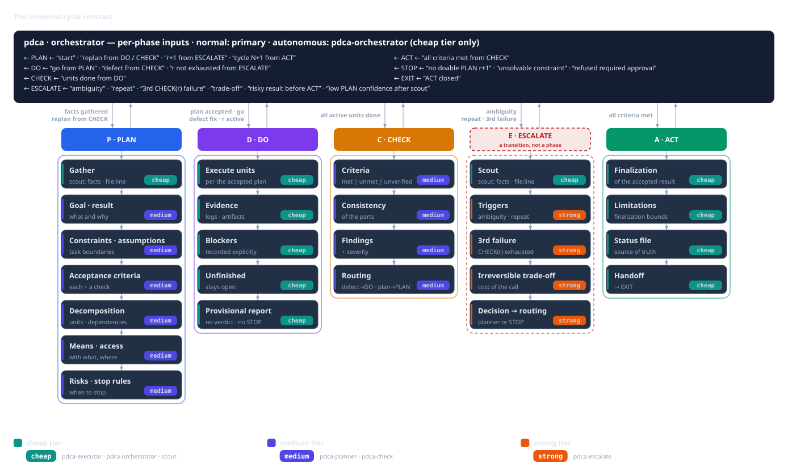
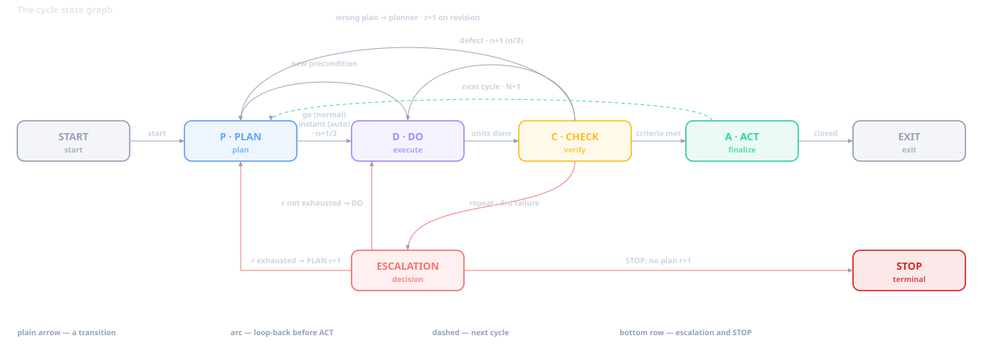

# Vibe coding: what's next?

Agents are a new development environment that effectively replaces the existing IDEs. In it, with nothing but a prompt, you can do all the same things as in any other IDE (writing code, tests, refactoring, static analysis, and so on). Only the way code is written has changed. You describe in natural language what you want to do, and the model implements it — finds files, edits code, runs commands. With the help of the model and the operating system's tools, the agent grasps what you want very quickly and delivers in minutes what used to take you a day.

Of course, this is a modern, progressive approach that gives a serious productivity boost — so what could possibly go wrong? Well, over time various little things start to annoy you. Either the model loses the thread and does something completely different from what you asked, or it fails to do what you stated explicitly and unambiguously. A few times the model genuinely drove me up the wall, when I had to literally retype the very same prompt for it to understand what to do. The same model that yesterday understood you at a word, almost read your mind, wrote fast and well — today, for some reason, starts dragging: asks silly questions, goes off to read documentation on the internet, re-reads your whole repository again, and so on. Once again you spend time and money on "retraining" it (immersing it in context, quite literally).

Then you begin to notice that it can report the task as done while having done nothing, or something completely different from what you asked. You spend time on an in-depth review of its handiwork, losing time and focus.

Of course, none of this is critical, and it's cured by setting behaviour rules, instructions, skills. Over time you'll accumulate working prompts, skills, and specs. On the whole it's a workable solution — I, too, have a set of skills for various tasks, various development artifacts, and input parameters. But what if you want more? More quality, for instance?

## Almost euphoria

For the first few months, frankly, I was impressed by prompt engineering. Modern IDEs with IntelliSense and IntelliCode lower the barrier to entry, you say? Nonsense! Now you don't need to remember the syntax, the library, or the exact API at all — describing in natural language what you want is enough, and all the wiring of complex libraries and the calls to their methods, which you previously had to remember or look up and hand-code, magically appear by themselves. You don't have to burden your head with the small stuff — the boilerplate, the configs, the tests, the performance measurements — the model does it itself while you keep the main idea in your head.

At first I collected successful prompts. For a one-off solution that seems ideal. A prototype, a script "for today", a demo of an idea, a trial of an unfamiliar technology, writing tests for finished code. In a couple of months they had grown into a set of skills that helped me achieve repeatability and a certain level of quality. I told the model where to look, what to treat as the readiness criterion, how to verify the result. The skills set behavioural patterns for the model so that its line of thought went in the direction I needed. On the whole they helped a lot — up to a certain point.

## The complexity threshold

If the task was complex and hard, it became long, the context grew, the limits blew past within minutes, and the money on API plans burned even faster. Keeping a big, long task entirely on an expensive model is costly. Switching to a cheap one is very expensive, because you have to fiddle with the context by hand.

The problem with simple prompts and one-liner skills is that they're linear. Once I realised we needed cyclicity, the idea of using the management cycle Plan — Do — Check — Act came immediately. I took my existing work — the prompts, the skills — reconciled them with PDCA theory, and out came the `pdca` skill.

By that point I had already heard the term harness engineering, but imagine my surprise when, by trial and error, I had reinvented an approach now known as loop engineering and positioned as the next stage in agentic development.

OK, did a miracle happen? Of course not! The first thing I ran into after launching the skill was that it got slower. The cycle sets rigid bounds on the model's reasoning and demands a verifiable result: for instance, after the changes performance must not degrade or coverage must not drop. With this approach you can no longer have a casual simple refactor — the cycle will sit over a trivial edit for 20–30 minutes, whereas before, in prompt mode, it was done as quickly as in an IDE. But in exchange I got two important things.
1. a result that became verifiable and predictable.
2. a quality that became noticeably higher.

## How the skill works



The skill defines a fixed set of roles, each with an attached set of functions and permissions. A role has an attribute — **Tier** — which describes the complexity of the tasks assigned to that role. The task complexity determines which model suits them best. I singled out three levels — cheap / medium / strong. The tier is a measure of a model's cost and quality. Another role attribute is permissions. They, too, depend on the tasks being solved. A strong model, oddly enough, will have fewer permissions than a cheap one. I'll cover that effect in the economics section. Different harnesses implement roles differently; personally I live in opencode, where this maps beautifully onto the notion of subagents. The skill knows nothing about models and permissions — it operates only with roles. The harness implements a role via subagents, giving them specific models and permissions.

The skill takes a task or goal as input. It can't be changed or reformulated inside the skill (only the user may do that). If the skill realises it's unachievable, the cycle stops.

Planning gives birth to the status file, and that file is the skill's main artifact.

All the work is done by subagents implementing specific roles:

| Role | What it does | Tier |
|---|---|---|
| GATHER — Scout | Collects pointers `file:line`, URLs, numbers; no recommendations | cheap |
| PLAN — Analyst | Goal, acceptance criteria, decomposition, risks, verification method | medium |
| DO — Executor | Edits files, runs commands, keeps the status file | cheap |
| CHECK — Auditor | Independently verifies every criterion against actual evidence | medium |
| ESCALATE — Expert | The instance for hard decisions | strong |
| RUNNER — Orchestrator | Drives the cycle, reading and editing nothing | cheap |

Next, the skill defines the rules of interaction between the roles:

- **The orchestrator** drives the cycle but reads and changes nothing. As a rule it's the primary agent on a cheap or free model. It dispatches the roles through `Task` (the subagent-launch tool) and passes information from one to another. It doesn't write the plan, doesn't read files, doesn't run commands; the exception is updating execution progress (the task list).
- **The scout** is a universal role, used by all the non-cheap models to shovel through raw information.
- The plan always belongs to the **analyst**. It both drafts the initial plan and revises it when the corresponding signal arrives.
- Only the **executor** may write and run — including the status file.
- The **auditor** collects evidence (with the scout's help) of the work done. It receives the report from the executor and the acceptance criteria from the analyst, and tries on its own, independently, to assess whether the result holds.

The harness's permission mechanism sets constraints for the roles:
 - only the executor may write and run (exec), otherwise the source of changes multiplies.
 - reading is available only to the executor, the scout, and the expert.
 - The medium and strong tiers don't work with raw information. A file read or documentation downloaded from the internet enters the context in full, although perhaps only a single line is needed to make the decision. So raw data is read only by the scout, which returns pointers to the orchestrator, and the orchestrator then dispatches them to the stronger roles.

## Technical details

The skill's state machine looks like this:



PLAN. The analyst decomposes the goal and answers the question of what result is needed. The decomposition goes down to atomic, indivisible tasks with clear boundaries — **units**. A unit is one verifiable piece of work with its own acceptance criteria. The plan's mandatory fields:

- the expected result;
- constraints and assumptions;
- measurable acceptance criteria;
- decomposition with dependencies, or an explicit decision not to split;
- means and access;
- risks and stopping conditions.

DO. The executor does only what the plan says; a change beyond the unit is out of bounds. Once the work is finished it hands the orchestrator essentially a draft, whose correctness the auditor verifies.

CHECK. The auditor judges every answer against actual evidence and checks that the evidence isn't self-contradictory. The auditor forms a verdict in terms of the acceptance criteria and hands it to the orchestrator. An implementation defect goes back to DO, a wrong plan goes back to PLAN.

ACT. Closes the cycle: it records the conclusions, limitations, status, and handover, and finalizes the status file.

If it turns out that one more thing must be done before the current unit (DO can return the work to PLAN, putting the current unit in a blocked state), the analyst adds a new active unit. When the new unit completes, the original unblocks and continues with the same criteria.

If the original unit is no longer achievable, a new one supersedes it, and the original is marked `superseded`. So that no requirement is lost in the supersession, the new unit inherits all the criteria of the original, and CHECK verifies them by the same scenario.

Execution can't move from one state to another until it passes a gate:

- Plan → DO: all mandatory fields are present, the plan is written to the status file, and approval from the user is obtained — or the run is in autonomous mode.
- DO → CHECK: all active, non-superseded units are done with evidence.
- CHECK → ACT: all criteria are checked, not a single one failing or unverified.
- ACT → EXIT: the result and the status file are finalized.
- STOP: a separate finalization, outside the series of transitions above.

Since the graph allows returns, cycle counters have to be kept. The orchestrator keeps three counters:

- `N` — the number of the task's cycle in the file name `.pdca/status/&lt;task&gt;-&lt;N&gt;.md`; it grows only in ACT, when the next cycle of the same task is planned.
- `r` — the plan revision; it grows only with a genuinely different plan (DO or CHECK may request a plan change).
- `n` — the attempt at executing the current revision: starts at 1, the `CHECK → DO` transition increments it by 1, and a new revision resets it to 1.

A defect history is kept as well. It isn't erased by a plan revision or a new session; it exists so you don't loop on the same mistake.

The counters and the history live in the status file.

The orchestrator hands control to the Expert when the execution attempt `n` reaches three — that is, the Auditor has rejected the implementation three times. In that case the Expert has two options:
1. Provide a new input for re-planning (return to PLAN). In that case `r` grows and `n` resets.
2. Find no solution and stop the cycle.

If the Auditor accepts the implementation, it issues its verdict and the Orchestrator moves to ACT, where the cycle ends.

## A real-world example

In one large, complex project there was a task that the `pdca` skill returned to four times. The detailed log is below, but here's what happened in outline:
### Cycle 1
The orchestrator decided to stop the work, because escalation found no confirmation from the user that the plan was approved.
### Cycle 2
- The Auditor rejected a unit three times, escalation followed. The Expert accepted the work.
- The next unit also failed three times, and this time the Expert didn't accept the work: the task remained unfinished.
### Cycle 3
I stepped in and pointed out that the acceptance criterion which had failed the previous revision was being dropped (with a record in the status file). I asked for the work to continue. The next unit, which was supposed to take a different measurement, was also rejected by the Auditor. Escalation happened again, and the Expert decided that we close the task as done, but with the limitations recorded.
### Cycle 4
The task came back to me once more; I reformulated the requirements again and sent it back for rework. With the new implementation the Auditor found six defects on the first iteration and handed it back to the executor. A repeat defect from the executor went to the Expert, who accepted the work partially and asked for one aspect to be re-measured. The measurements came out positive, and the task was finally closed for good.

Needs collapsing here — the real task log
```
Cycle 1 (Oct 4, 13:30). The skill stopped before doing any work: escalation decided that writing code without an approved written spec was not allowed. Status incomplete, no code, commit 01f3e92. This was not a failed implementation but a missing permission.
Bridge into cycle 2. You approved the document iteration-15-cached-path-design.md, commit 5137ec8 "written spec approved; reopen group-1". Cycle 2 starts from that permission.
Cycle 2 (Stage A) (≈16:40–17:42, r=2). Planning work: decomposed the cached path, fixed a baseline and budgets. This is not the optimisation itself but preparation. n reached 3/3, and escalation decided simply to accept stage A ("No replan, no STOP, no fourth CHECK", 183-2.md:232). Then a separate attempt B1: replace the private Dictionary with a built-in store of four pairs. Three CHECK failures in a row, escalation: accept only with a controlled measurement under the condition loadavg(1m) < 1.0. In the quiet environment the measurement was not taken, so the fallback kicked in: B1 incomplete, the patch neither accepted nor committed (b1.md:461-469).
Cycle 3 (Oct 4, 20:40, autonomous + auto-commit, 7eb5899, r=2). Your directive: don't stop the group on the time metric, record the limitation and continue with B2. Inside, three units:
- U1 — re-measurement of B1: again could not prove the speed-up, the fallback repeated;
- U2 — a different approach, "guarded immutable refresh recipe", deliberately independent of B1's result. CHECK failed, the changes were rolled back, there was no plan revision (183-3.md:90-92);
- U3 / Stage C — escalation issued the final status: #183 = DONE (with limitation), B1 and B2 rejected. Closure — commit 04c0c96.
Cycle 4 (Oct 5, N=4, interactive, you gave the go). The issue was reopened. Here they rebuilt B1+B2 as an immutable ParamRefreshRecipe: the parameter-binding recipe is prepared in advance, and the per-hit Dictionary and the collector were removed. On the first CHECK six defects were found (among them a crash with InvalidCastException), one return to DO, escalation accept-with-open-AC4. Then AC4 was closed by a repeat ABAB measurement. Commits 322f9be and 79b48fd, acceptance passed.
```

## The experiment

Once the skill had more or less settled, I wanted to test it, so I set up an experiment. I took the same task in a project (a fairly complex one, where dynamic columns had to be added) and had the same model (DeepSeek V4.1 Flash) solve it in three different environments: plain, with no skills; with an eight-step instruction skill (one of my earlier, very successful skills); and with the new `pdca` skill. Each run was in a separate clone of the repository, with no history and no ready answer. Separately I ran a reference (my working role setup) on the working branch — the same feature, done by the same cycle but with expensive models: planning and verification on the medium model, escalation on the strong one.

| environment | time | files | own tests | P0 defects | cost |
|---|---|---|---|---|---|
| no skills | 16 min | 32 | 2 | 5 | $0.20 |
| a very good skill | 30 min | 37 | 7 | 4 | $0.33 |
| cycle, all roles on a cheap model | 78 min | 55 | 19 | 2 | $1.19 |
| cycle with expensive models | ≈40 min | 48 | 16 | 2 | $0.76 |

What we see: vibe coding is the unconditional leader in execution time, cost, and defect count. My previous skill, born out of prompts, did the job somewhat better, but twice as slowly. The `pdca` skills, though, are champions of quality. They wrote considerably more tests and left half as many critical defects. You can also notice that an ordinary linear skill is twice as cheap as the `pdca` skill — and twice as low in quality.

## The economics of tiers

A formalized skill costs more in time, tokens, and money. That holds as long as the comparison is against one or two prompts. On simple tasks, where the context is never lost, vibe coding is cheaper, and the cycle isn't needed. On complex tasks the cost of vibe coding is made up of a multitude of restarted sessions, repeated explanations of the task, code reviews, and the developer's hours spent restoring the thread of reasoning. The harder the task, the more expensive and inefficient vibe coding becomes. So if we want to compare money, we shouldn't compare "a prompt vs a cycle" but "a day of vibe coding vs a day in the cycle".

In a well-decomposed task almost all tokens go to mechanics: read a file, apply an edit, run the tests, collect excerpts. Decision-making is rare and expressed in short answers, which is why the strong models have a smaller set of permissions. A digest of an article, a line of code with its contract, a couple of numbers are enough for them. Tool output and internet scanning would only eat your tokens, so bulky, mechanical work goes to the cheap tier.

A snapshot from my own real usage: 12 hours of work, 159 sessions, 3829 messages, $7.34.

| Tier | Messages | Input, tok. | Output, tok. | Cost | Budget share |
| --- | --- | --- | --- | --- | --- |
| cheap | 3485 (91%) | 371.1M | 3.12M | $4.44 | 60% |
| medium | 113 (3%) | 3.36M | 116.5k | $2.70 | 37% |
| strong | 4 (0.1%) | 50.4k | 11.5k | $0.20 | 3% |

Input here is all input tokens, including cache reads and writes; output is the answer together with reasoning.

What does this table say? The strong tier was called four times over twelve hours. It barely works compared with the other roles, so its relative expensiveness gets lost in the total spend.
The medium tier was called considerably more. That tells us there were many verifications of the cheap tier and a large number of round-trips and returns to DO. It's expensive, but also under 40% of the total spend.

One subtlety about prompt cache is worth noting here as well. On expensive models the difference between writing to the cache and reading from it is a multiple: in my setup, on the strong tier, a read is $0.2/M against a write of $5/M — 25 times. A measurement on a live session: a warm repeat turn with a full cache hit cost $0.0034 against $0.0794 for a cold one — 23 times cheaper.

The biggest single source of expense is the coding itself. And no wonder, looking at the number of tokens it shovelled through over that time. If a medium model had done it, that one coding job over those twelve hours would have cost about $59 instead of $2.76, and together with the scout about $75 instead of $3.74. On flagship models it would already be about $150 — and that's without counting cache writes and reads, which are paid on expensive models.

## Takeaways

Do I imagine the skill is so smart that it can handle any task? No — it simply doesn't say "done" until it has verified. Because for it, done and not-done are equally valid outcomes. The model strives to satisfy your prompt; the cycle doesn't. It will mark the task `incomplete` if the acceptance criteria set during planning weren't met. Vibe coding in such a case can close the task as done, because it has no definition of done. If the result isn't verified, you're likely to catch a bug in production or get an angry review from a user.

The downsides of the `pdca` skill stem, as usual, from its upsides. The skill works much longer. A simple half-hour task turns into hours. The skill consumes more tokens. Several roles work, some of them on the medium and expensive tiers, and independent verification requires fresh runs. The skill is more complex both in design and in operation. You have to stand up the roles and tiers, and watch the status file and the gates. The barrier to entry is higher than for a single prompt.

So on a small one-off task the `pdca` cycle won't pay off — there it's simpler to tell the model by hand what to fix and where. The cycle is worth taking for long tasks with a large context, where you care about the result and the quality.


## Conclusion

The `pdca` skill isn't a silver bullet; your productivity won't go up from using it (rather the opposite). It's worth plugging in when you want a little more assurance of quality. Work on any complex task is iterative — you can't do it all in one sitting. The model is no exception: it, too, handles tasks far better when they are planned, decomposed, verified, sent back for rework, and lessons are drawn from them. Strong models can already do this on their own, but nobody has repealed the price/quality ratio. Happy coding!

## Open source

The skills discussed here — `pdca` and the applied `pdca-coder`, `pdca-dotnet`, `pdca-collection` — are open: <https://github.com/AlexeyShirshov/skills>.
