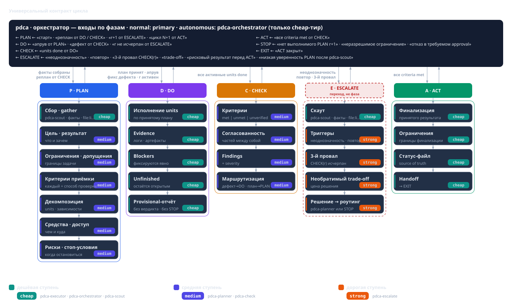
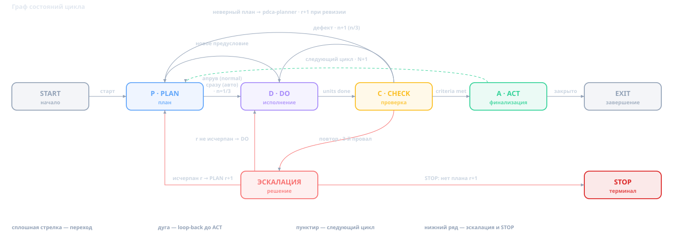

# Когда вайбкодинг надоел

Я работаю с моделью прямо в терминале, в opencode. Пишу текстом, чего хочу, — она читает файлы, правит код, запускает команды. Это правда быстро: то, что раньше занимало день, теперь делается за полчаса, и половину времени я в код даже не заглядываю.

Долго мне это нравилось. Пока не начал замечать две вещи.

Первая: утром я сажусь за задачу, которую вчера почти доделал, а модель про неё ничего не помнит — ни проекта, ни того, где мы остановились, ни того, почему пошли одним путём, а не другим. Вчера понимала с полуслова, сегодня — чистый лист. Каждый день я заново вводил её в курс дела.

Вторая: «готово» она говорит сама. Внешнего критерия у этого «готово» нет — сказала, и приходится верить. Много времени уходило не на написание кода, а на ревью и переделки после него.

Я не стал придумывать новое. Взял старый цикл **Plan — Do — Check — Act**, который давно прижился в разработке, и переложил его на работу с моделью — в виде скилла `pdca`.

## Чем вайбкодинг хорош

Первые месяцы я был в восторге, и не зря.

- **Порог входа падает.** Не нужно помнить синтаксис, библиотеку и конкретный API — достаточно описать словами, чего хочешь.
- **Обратная связь мгновенна.** Правка, запуск, следующая правка — секунды, без ритуала сборки и ревью.
- **Мелкое модель добирает сама.** Обвязку, конфиги, опечатки она закрывает, пока я держу в голове замысел.
- **Для одноразового это идеально.** Прототип, скрипт «на сегодня», демо идеи, разведка незнакомой технологии — тут вайбкодинг почти непобедим.

Пока результат нужен, чтобы «потрогать» идею, это честная сделка: скорость в обмен на контроль.

## Где он ломается

Проблемы начинаются, когда от результата нужно больше, чем «выглядит работающим»: повторяемость, объяснимость, цена ошибки.

- **«Готово» — это самооценка.** Критерия нет, работу закрывает сам автор. Это оценка, а не факт, и проверить её нечем.
- **Состояние живёт в одной сессии.** После сжатия контекста или в новой сессии непонятно, где остановились, что сделано и почему. Контекст обнулился — работу начинают заново.
- **Ошибки не наказываются.** Неудача не мешает попробовать ещё раз тем же способом. Однотипные повторы выглядят как прогресс, хотя это хождение по кругу.
- **Результат не воспроизводится.** Тот же запрос к той же модели даёт другой ответ, иногда нерабочий. Принять такое на веру нельзя.

В сумме это и есть непредсказуемость: вайбкодинг может дать результат, но не обещает, что получится нужный и что его удастся повторить.

## Как я к этому пришёл

Сначала я делал то же, что и все: копил удачные промпты. За пару месяцев из них сложился набор скиллов — по сути, инструкций для модели: где искать, что считать критерием, как проверять результат. Они задавали рамки и здорово помогали — ровно до тех пор, пока задача влезала в одну сессию.

Как только задача становилась длинной, начиналась арифметика, которая мне не нравилась. Держать её целиком на дорогой модели дорого. Переключаться на дешёвую — значит каждый раз заново выгружать контекст. Я только этим и занимался.

Идею я не выдумывал. Взял управленческий цикл Plan — Do — Check — Act, который давно прижился в разработке, и переложил его на работу с моделью. Получился скилл `pdca`.

Что изменилось сразу — стало дольше. Переименование метода, на которое уходило три минуты, теперь занимает полминуты на каждую правку, а простой задачей я могу провозиться несколько часов. Цикл жёстко задаёт рамки и требует проверяемого результата: например, после изменения производительность не должна просесть, и это надо доказать, а не заявить.

Взамен я получил две вещи. Первое — проверяемый и предсказуемый результат. Второе — качество, которое заметно выше: по логам почти никогда задача не закрывается с первой итерации, потому что модель сама находит свои ошибки на этапе проверки и отправляет работу обратно.

## Роли в цикле

В цикле есть фиксированный набор **ролей**. Роль — это не человек и не конкретная модель, а функция с правами. **Тир** (cheap / medium / strong) — ярлык стоимости и качества модели, а не полномочие: дешёвая роль может иметь больше прав, чем дорогая. Каких агентов и модели поставить на роли, решает хост — окружение запуска; сам скилл называет только роли.

| Роль | Что делает | Тир |
|---|---|---|
| GATHER — Скаут | Собирает указатели `file:line`, URL, числа; без рекомендаций | cheap |
| PLAN — Аналитик | Цель, критерии приёмки, декомпозиция, риски, способ проверки | medium |
| DO — Исполнитель | Правит файлы, запускает команды, ведёт статус-файл | cheap |
| CHECK — Аудитор | Независимо проверяет каждый критерий по фактическим свидетельствам | medium |
| ESCALATE — Эксперт | Инстанция для трудных решений | strong |
| RUNNER — Оркестратор | Ведёт цикл, ничего не читая и не правя | cheap |

Таблица работает, пока соблюдаются четыре правила.

- **Оркестратор ведёт цикл, но ничего не читает и не меняет.** Он только диспетчеризует роли через `Task` (инструмент запуска субагента) и передаёт им информацию друг от друга. План он не пишет, файлы не читает, команды не запускает; исключение — обновление списка задач.
- **План всегда за аналитиком.** Он и составляет начальный план, и пересматривает его, когда приходит соответствующий сигнал.
- **Писать и запускать может только исполнитель** — включая статус-файл.
- **Аудитор не зависит от автора.** Он судит по агрегированному отчёту со свежими прогонами и фактами от скаута.

Отсюда три запрета на «само». **Самовердикт**: работу делает исполнитель, а принимает независимый аудитор. Если бы автор сам решал, что критерии сошлись, проверка превратилась бы в самоотчёт. **Саморедактирование**: писать и запускать может только исполнитель, иначе источник изменений раздваивается. **Самочтение**: прочитанный файл не выкинуть из контекста, поэтому сырые данные читает только скаут и возвращает указатели, а оркестратор лишь диспетчеризует.

## Как идёт цикл

Машина состояний цикла выглядит так:

**PLAN.** Аналитик декомпозирует цель и отвечает на вопрос, какой результат нужен. Цель должна присутствовать на входе в цикл: она сформулирована заранее и не может быть изменена. Декомпозиция идёт до атомарных неделимых задач с чёткими границами — **юнитов**. Юнит — один проверяемый кусок работы со своими критериями приёмки. Обязательные поля плана:

- цель и ожидаемый результат;
- ограничения и допущения;
- критерии приёмки — **каждый со способом проверки**;
- декомпозиция с зависимостями или явное решение не дробить;
- средства и доступ;
- риски и условия остановки.

Пробел в исходных данных закрывается фактом, явным допущением или блокером. Догадки запрещены.

**DO.** Исполнитель делает только то, что сказано в плане; изменение за пределами юнита — «Over-Reach» — отдельная задача. Вердикт и STOP не его: он возвращает оркестратору **предварительного кандидата со свидетельствами**, и ответ «результат достигнут» никогда не закрывает цикл. Вердикт принадлежит CHECK.

**CHECK.** Аудитор судит каждый ответ **по фактическим свидетельствам** и проверяет, что они не противоречат друг другу. Статусы: `met` (выполнен), `unmet` (не выполнен), `unverified` (не проверен). Отсутствие проверки — не пропуск: без чисел и указателей критерий получает `unverified`, а не `met`. На выходе — вердикт, матрица критериев, находки и маршрутизация: дефект реализации возвращается в DO, неверный план — в PLAN.

**ACT.** Завершает цикл: фиксирует выводы, ограничения, статус и передачу дел, финализирует статус-файл. Без ACT цикл не закрыть, а без принятой проверки нет ACT. `rework` и `replan` — не часть ACT, а **возвраты до** него.

**Возвраты.** `CHECK → DO` — дефект реализации: исправить и проверить снова. `CHECK → PLAN` — неверный план: аналитик выдаёт новую ревизию. `DO → PLAN` — новое предусловие или блокер: не самовольный пересмотр, а кандидат на разбор аналитиком.

Когда посреди работы набор юнитов меняется, важно различать два случая.

Если выясняется, что перед текущим юнитом нужно сделать ещё один, то в план просто *добавляют* новый активный юнит, а исходный остаётся в статусе `blocked` и сохраняет все свои критерии. Маппинга между ними нет и не нужно: новый юнит не заменяет старый, а лишь идёт перед ним — когда он сделан, исходный разблокируется и доводится до `done` по своим же критериям. Это называется **аддитивное предусловие**.

Если исходный юнит больше не достижим, его вытесняет новый. Исходный помечается `superseded`, и это уже настоящая подмена. Чтобы при вытеснении не потерять требования, обязателен маппинг «вытесненная → замена»: новый юнит наследует все критерии исходного, и CHECK проверяет их по-прежнему. Без такого маппинга вытеснять нельзя — иначе часть требований тихо испарится. Это называется **замена области**.

Коротко: при аддитивном предусловии исходный юнит живёт дальше (`blocked`) и маппинга нет; при замене области он умирает (`superseded`), и маппинг со всеми его критериями обязателен.

**Пять гейтов** разрешают переходы:

1. **План → DO:** все обязательные поля на месте, план записан в статус-файл, получено подтверждение от пользователя или оркестратора.
2. **DO → CHECK:** все активные, не вытесненные юниты `done` со свидетельствами.
3. **CHECK → ACT:** все критерии `met` на фактических данных, ни одного `unmet` или `unverified`.
4. **ACT → EXIT:** результат и статус-файл финализированы.
5. **STOP:** отдельная финализация, вне ряда переходов выше.

Нерушимы два инварианта: **нельзя пропустить CHECK** и **нельзя закрыть цикл без ACT**.

Прогресс считают **три счётчика** и **история дефектов**:

- `N` — номер цикла задания в имени файла `.pdca/status/<task>-<N>.md`; растёт только в ACT, когда планируется следующий цикл того же задания.
- `r` — ревизия плана; растёт только при действительно другом плане.
- `n/3` — попытка исполнения текущей ревизии: старт с 1, `CHECK → DO` увеличивает, новая ревизия сбрасывает в 1.
- **История дефектов** — по строке на стабильный ключ дефекта: ревизии и попытки, число исправлений, указатели, исход эскалации. Не стирается ни пересмотром, ни новой сессией.

Отклонённый кандидат с неизменным планом — **не** ревизия: `r` и `n` не меняются, а переименование или сброс сессии ревизию не «производят». Счётчики и история живут в статус-файле и помогают отличить «ещё одну попытку» от пересмотра и вовремя позвать эскалацию: **повтор того же дефекта после одного исправления** — сигнал раньше, чем три разные неудачи. После третьего провала CHECK на одной ревизии четвёртой попытки нет.

**Режимы.** В **normal** после записи плана оркестратор показывает его суть, даёт путь к статус-файлу и просит подтвердить — это единственный сигнал старта. Без подтверждения ничего не создаётся и не редактируется, кроме статус-файла. В **autonomous** тот же контракт идёт без пауз: переходы случаются в тот же ход, когда пройден гейт, ничего «для пользователя» не печатается, а уведомления (недоступная роль, восстановление после сжатия контекста, допущение вместо вопроса) пишутся в статус-файл как `Notice:`.

**Память и доказательства.** Статус-файл цикла — источник истины по плану и прогрессу. Он лежит на диске, переживает сжатие контекста и новую сессию, и исполнитель обновляет его на каждом событии. Todo-список в сайдбаре — лишь сессионное зеркало и источником истины не бывает. После сжатия контекста состояние восстанавливают из статус-файла, а не по памяти. Цикл закрывается только на **свежих свидетельствах** — код выхода, числа, путь к логу, `file:line` — и никогда на утверждении, включая отчёты субагентов. «Должно работать» и «вероятно» — повод назначить повторный прогон: отчёт не равен результату.

## Что я измерил

Когда скилл более-менее устоялся, я захотел не ощущений, а цифр. Взял одну и ту же задачу в проекте nextorm (#94, динамические колонки) и дал её решить трижды одной и той же модели, DeepSeek Flash, в трёх разных средах: в чистом виде без скиллов, со скиллом-инструкцией на восемь шагов и с моим циклом. Каждой — отдельный клон репозитория, без истории и без готового ответа. Отдельно прогнал эталон: как эту же фичу сделал человек.

| среда | время | файлов | своих тестов | P0-дефектов |
|---|---|---|---|---|
| без скиллов | 16 мин | 32 | 2 | 5 |
| скилл | 30 мин | 37 | 7 | 4 |
| цикл | 78 мин | 55 | 19 | 2 |
| человек | — | — | — | 2 |

Тут легко соврать и выставить цикл победителем. Он им не был: по оценке независимого судьи он даже не первый. Но я смотрел не на оценку, а на то, что остаётся после работы. Цикл написал в десять раз больше собственных тестов, чем чистый прогон, и оставил вдвое меньше критичных дефектов — ровно столько же, сколько у человека. Чистый прогон отдал фичу с двумя тестами и пятью P0; переделывать пришлось бы всё равно, просто позже и уже на живом коде.

## Как это выглядит на длинной задаче

Однажды цикл в четвёртый раз вернулся к одной задаче про кэш запросов — #183 в том же nextorm. К первому CHECK он нашёл в собственной правке шесть дефектов, один из них — падение с `InvalidCastException` на вполне обычном запросе. CHECK сказал «не принято», и работа ушла обратно в DO, не в отчёт. Дошло до того, что на разбор позвали модель посильнее, а в статус-файл честно записали, что именно осталось открытым. Важное тут не то, что цикл такой умный. Важное — что он **не сказал «готово»**. Вайбкодинг на этом месте сказал бы.

## Во что это обходится

Ничего не бывает бесплатно. Главные минусы цикла:

- **Дороже по времени.** Простая задача из получаса превращается в часы.
- **Дороже по деньгам.** Работают несколько ролей, часть на среднем и дорогом тирах, а независимая проверка требует свежих прогонов.
- **Сложнее.** Нужно поднять роли и тиры, следить за статус-файлом и гейтами. Порог входа выше, чем у одного промпта.

Это плата за предсказуемость и честную остановку. На маленькой разовой задаче цикл не окупится — там проще подсказать модели вручную, что и где поправить. Цикл стоит брать для длинных задач с большим контекстом и для команд, которым важен результат.

## Экономика тиров

Тут я себе не льщу: формализованный цикл дороже по времени, токенам и деньгам. Но это верно, пока сравнение идёт с одним-двумя промптами. На простых задачах, где контекст никуда не теряется, вайбкодинг дешевле, и цикл не нужен. На сложных цена вайбкодинга складывается не из промптов, а из перезапущенных сессий, повторных объяснений задачи и часов на восстановление нити рассуждений. Эта часть растёт вместе со сложностью задачи, а накладные расходы цикла — нет. Поэтому для сложных задач честное сравнение — не «промпт против цикла», а «день вайбкодинга против дня в цикле».

Ключ в том, что в хорошо декомпозированном цикле почти все токены уходят на механику: прочитать файл, применить правку, прогнать тесты, собрать выдержки. Суждение — «что делаем дальше», «зачтено ли» — компактно и случается редко. Тиризация и есть маршрутизация этих двух потоков: объём — на cheap, суждение — на medium, разбор тупика — на strong. Платить флагманскую цену за правку в десять строк бессмысленно.

Качество при этом держит не цена модели, а устройство цикла. Дешёвый исполнитель не выносит вердиктов: его работу зачитывает независимый CHECK на среднем тире, со свежими прогонами. Сними запрет на самовердикт — и вся экономия мгновенно обернётся потерей качества.

Срез с моего реального использования: 12 часов работы, 159 сессий, 3829 сообщений, $7.34.

| Тир | Сообщений | Вход, ток. | Выход, ток. | Стоимость | Доля бюджета |
| --- | --- | --- | --- | --- | --- |
| cheap | 3485 (91%) | 371.1M | 3.12M | $4.44 | 60% |
| medium | 113 (3%) | 3.36M | 116.5k | $2.70 | 37% |
| strong | 4 (0.1%) | 50.4k | 11.5k | $0.20 | 3% |

Вход здесь — все входные токены, включая чтение и запись кэша; выход — ответ вместе с reasoning.

Начну с strong: четыре вызова за двадцать центов за двенадцать часов. Дорогой тир работает как страховка: почти бесплатен, пока всё идёт штатно, и бесценен, когда цикл упёрся. Альтернатива — четвёртая и пятая слепая попытка среднего тира с полным контекстом. Они обходятся дороже одной эскалации и не дают задаче нового взгляда.

Эффект тиризации усиливает prompt cache. У дорогих моделей разница между записью в кэш и чтением из него кратная: в моём сетапе на strong чтение $0.2/M против записи $5/M, в 25 раз. Замер на живом сеансе: тёплый повторный ход с полным попаданием в кэш обошёлся в $0.0034 против $0.0794 у холодного, в 23 раза дешевле. Оговорюсь честно: если попаданий в кэш нет, экономии нет, и обещанный процент публиковать нельзя. Кэш надо держать тёплым осознанно.

И два случая, когда тиризация не окупается вовсе. Первый — одномодельный профиль: если все роли привязаны к одной модели, экономить негде, и от цикла остаются только организационные выгоды. Второй — мелкие разовые задачи: накладные расходы цикла съедят любую разницу в цене тиров.

## Заключение

`pdca` не обещает правильный результат. Он не даёт закрыть работу без проверки, молча потерять состояние или выдать повтор за прогресс. Гейты проверяют присутствие нужных пунктов, независимый CHECK судит по свежим свидетельствам, а STOP честно фиксирует, где проверяемый результат исчерпан.

А кто у вас выносит вердикт «готово» — человек, ревью или автоматика? Расскажите в комментариях.

## Открытый код

Скиллы, о которых шла речь, — `pdca` и прикладные `pdca-coder`, `pdca-dotnet`, `pdca-collection` — открыты: <https://github.com/AlexeyShirshov/skills>.
