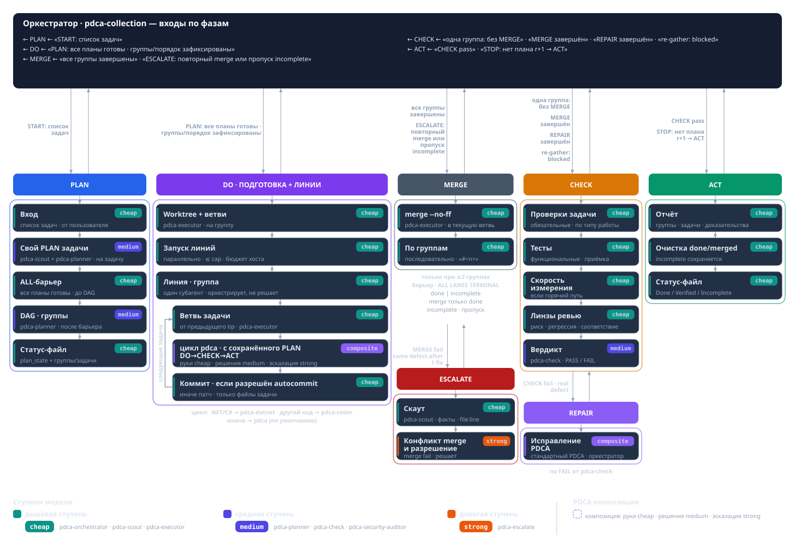
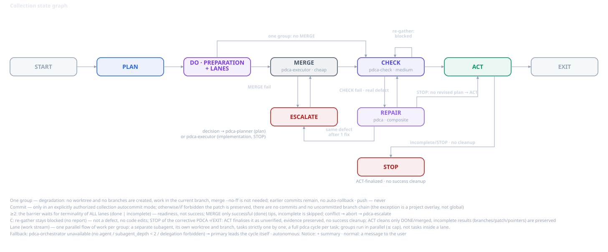
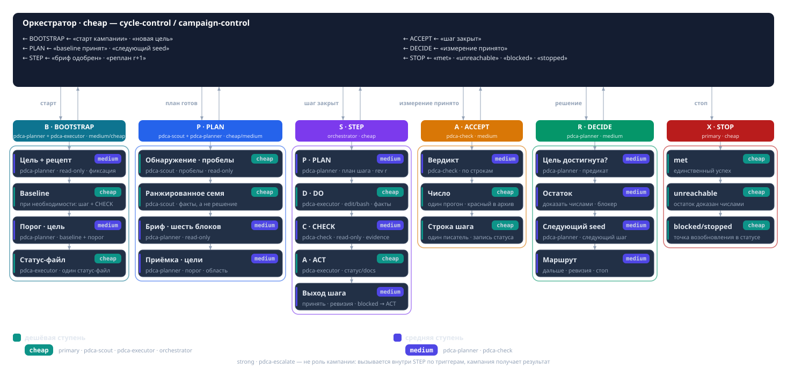

# Как сохранить контроль за кодом в эпоху ИИ

В этой статье мы продолжаем рассматривать набор скилов, которые помогают разложить работу на относительно прозрачные, проверяемые и предсказуемые шаги. Таким образом разработчик может сохранить контроль и понимание, а также не терять причастность к создаваемому продукту.

Агенты намного производительнее человека. В короткий промежуток времени они могут сгенерить очень много кода. Как это ни странно звучит, но требования к компетенциям инженера ИИ не падают, а возрастают. Современный разработчик в агентской среде испытывает большую нагрузку, чем без нее, так как ему необоходимо понимать все те бесконечные предложения, прототипы, классы, интерфейсы, тесты и прочее, которыми его засыпает ИИ. Он должен уметь выбирать из множества вариантов, которые ему предлагаются, он должен понимать обоснование каждого решения и аспекта разработки. В противном случае, при отстутствии контроля над этим процессом, у человека скоро пропадает понимание о том, над чем он работает. Он теряет причастность к решению с технической точки зрения, хотя при этом остается ответственным за него. Возникает противоречие - с одной стороны куча чужого кода (местами не тривиального), с другой - ваша обязанность понимать, отвечать и владеть продуктом. 

Если все пустить на самотёк, то вы постоянно будете сталкиваться с PR на 500+ файлов, бранчами на тысячи коммитов и т.д. Единственный способ это переварить - взять другого агента, чтобы он делал ревью и прогонял тесты. В этом случае человек дейсвительно превращается в мясного прокси и теряет всякий контроль над проектом. Это плохо, если вы не фрилансер. Вам платят зарплату за ваш код, несмотрят на то, что его сгенерировала модель. Вы несете конечную ответственность за работоспособность решения. Раньше, когда код писался вручную, мы также отвечали за продукт, хотя имели очень ограниченный контроль над ним. Мы использовали фреймворки, библиотеки, автосгенеренный код, драйвера операционной сисемы в конце концов и другие чужие функциональные блоки, оставаясь ответственными за все решение целиком. Сейчас и код становится чужим, но владение над ним никуда не пропадает. Владеете им по прежнему вы.

В предыдущей статье я рассмотрел один из подходов, который позволяет иметь чуть больший контроль над реализацией. Он дает больше понимания и больше артефактов для человека чтобы не терять смысл выбранных решений. Скил, рассмотренный в предыдущей статье подходит для реализации понятной и ограниченной задачи, для которой можно подобрать проверяемые критерии приемки. Такие задачи могут быть сложны в реализации и объемны по времени, но с точки зрения аналитики не являются сложными. Как правило, такие задачи получаются при декомпозиции более комплексной задачи. Эта статья описывает подход для решения более сложных задач, где треботвания к пониманию и контролю возврастрают.  

## Что делать с большими задачами

Самый простой и прямолинейный способ - отдать задачу целиком агенту. Если модель сильная, она может работать в таком режиме. Слабая либо справится с этим плохо, либо не справится совсем. Но даже при удовлетворительном результате на выходе будет куча кода, тестов и огромный PR с сотнями коммитов. Если заранее понимать внутреннее устройство не требуется, можно сказать модели: напиши приложение или игрушку, где летают самолётики и сбивают шарики. И тогда действительно она напишет какую-то мега-игру с тысячами строк кода, с разными бэкендами, фронтендами, базами данных и так далее. Можно ли это запускать в прод и показывать заказчику, не имея контроля и понимания, что внутри? Вайбкодинг на таких сложных задачах может не справиться.

Серьезный подход требует анализа и декомпозиции. Мы заранее нарезаем работу на более мелкие задачи с чёткими границами и определениями. Только потом отдаём их на реализацию, по одной или всем списком. Это первый и обязательный шаг для сохранения контроля над проектом. Каждая задача должна быть проработана (прожарена) и документирована. Есть масса скилов, которые ускоряют и улучшают этот процесс, однако это за рамками нашей статьи. Рассматриваемые скилы относятся к процессу SDLC не вообще, а конкретно к этапу реализации.

## Зачем нужны скиллы

Большую задачу вроде «Напиши проект, где летают самолёты и что-то сбивают» нужно разбить на более мелкие подпроекты. Эти подпроекты должны быть разбиты на эпики, эти эпики должны быть разбиты на какие-то задачи, подзадачи и так далее. Всё это должно попасть в бэклог. Тогда мы будем точно знать, что представляет собой продукт и как он будет работать хотя бы в первой версии.

Отправлной точкой разработки скилов PDCA-*, описанных ниже стало решение проблемы автономной работы над списоком тикетов из такого беклога. При наличии списка задач, довольно трудоёмко, долго и дорого реализовывать их по одному. Если передать список одним промптом почти наверняка агент встанет на середине работы по той или иной причине. Агент может попросить подтверждение пользователя. Артефакты предыдущей задачи остаются в worktree. Он может не сообразить, как скомпоновать задачи и выстроить зависимости.

Именно эти задачи можно отдать скиллу pdca-collection: каждую он выполнит отдельно, со своими тестами, логами и статусом.

Второй скил - pdca-incremental используется для менее определенных задач, где понимание объема и границ не четкое. Цель может быть измеримой и однозначной, но способы её достижения пока неизвестны. Или зависят от факторов, которые заранее рассчитать либо невозможно, либо неоправданно дорого. Такие задачи мы не можем нарезать на подзадачи, нам известно только как можно начать ее делать, т.е. первые шаги. Дальший ход будет зависеть от результатов этого первого шага и других вводных, которые мы получим в ходе реализации. 

Рассмотрим оба этих скила.

## PDCA Collection

Здесь используется так же концепция ролей и тиров, которая описана в предыдущей статье.

На вход скилу поступает набор задач в той или иной форме. Например, это может быть промпт "все открытые задачи в таком-то эпике" или "все открытые задачи в таком-то релизе", ссылка на список задач и так далее. Скилл не декомпозирует задачу на набор мелких. Он работает с уже заранее определенным списоком задач.

Разберем каждый из этапов скила по отдельности.

### Планирование

Первым делом скил запускает планирование с определенной степенью параллелизма для каждой из задач в списке. Планирование происходит в специальном субагенте - планер, который классифицирует эту задачу и пишет для неё критерии приёмки. 
Исходя из анализа сущности задач, драйвер выполняет их кластеризацию, то есть разбивает на независимые группы. Группа определяется тем, что ее задачи затрагивает одинаковые блоки кода и не могут выполняться параллельно. Напротив, задачи в разных группах как раз-таки могут выполняться параллельно. После кластеризации выполняется анализ зависимостей, который определяет последовательность выполнения задач внутри одной группы.

### Реализация

Если получилось более одной группы, то для каждой из них создается отдельный бранч и ворктри. Если все задачи выполняются последовательно в единственной группе, то работа происходит в текущем бранче и ворктри. Каждая группа может быть запущена параллельно. Степень параллелизма не определена, но как правило агент выбирает 2 или 4 параллельных выполнения.
Группа считается завершенной, если все задачи в ней завершены. Если хотя бы одна задача в группе завершена, но не выполнена (incomplete), группа считается incomplete. Если в группе нет невыполненных задач, она считается успешной. После завершения всех групп, начинается этап слияния успешных групп. Не успешные группы не сливаются и требуют отдельного ручного действия (как правило, перезапуск скила после завершения текущего). При слиянии групп может возникнуть конфликты, которые разрешаются через эскалацию.

### Интеграция

Каждая из задач группы имеет собственную реализацию и приемку. Но успешность отдельных задач не означает успешность всего списка. Нам необходимо скомпилировать результаты всех этих задач в один единый кусок кода и выполнить интегральную приемку всей коллекции. Своих тестов у коллекции нет: скилл не знает, из какой большой задачи собрался этот список. Но проверить нужно хотя бы то, что решение компилируется и интеграционные тесты зелёные.

Интеграция связана со слиянием нескольких веток в Git или слиянием нескольких worktree. И, как правило, это самостоятельный, бывает, что очень сложный процесс. Даже при изоляции групп возникают конфликты слияния. Чтобы всё компилировалось и работало, иногда приходится писать новый код.

### Закрытие

После слияния всех груп и успешной интеграционной проверки, коллекция завершается с сохранением соответствующих артефактов и обновлением статус-файла.

Граф состояний скила описан ниже

## PDCA Incremental

Этот скил используется когда задача известна, однако что именно мы будем делать в процессе ее реализации неизвестно. Единственное что мы можем определенно знать - что мы будем делать на первом шаге. Цикл здесь тоже есть, но выполнять его нужно последовательно: каждый шаг создаёт входные данные для следующей итерации. Таким образом, мы инкрементально, шаг за шагом, продвигаемся к цели без чёткого понимания всей работы, которая необходима для ее достижения. 

### Подготовка

На этапе подготовки мы определяем метод, с помощью которого цель будет измеряться, а также сразу же производим измерение этой метрики. Если метрика удовлетворяет цели - цикл сразу заканчивается. Например, задача поднять покрытие до 75%. Сначала выбираем методику измерения, потом измеряем текущее покрытие. Если оно меньше, чем 75%, тогда, ну да, мы запускаем задачу и начинаем эту цифру доводить до целевой. Если она больше или равна, то, в принципе, на этом цикл и заканчивается. То есть скилл заканчивает работу и говорит, что цель уже достигнута.

### Планирование

На этом этапе мы записываем статус файл и формулируем цель для первого этапа наших итераций.

### Реализация

Далее задача передаётся исполнителю, который продумывает и реализует один инкремент по поставленной цели. Если речь идёт, например, о покрытии, то он определяет, какие строчки кода не покрыты, и пишет для них тесты, энное количество тестов.

### Приемка

После чего мы в CHECK замеряем новое значение по покрытию. И если оно достигло нашего показателя, в принципе, на этом работа цикла заканчивается. Если оно не достигло, то мы всё повторяем заново. И так до тех пор, пока не достигнем целевого показателя.

### Пример

Другой пример такой инкрементальной работы - это увеличение производительности. Например, мы говорим, что этот метод необходимо оптимизировать, чтобы количество аллокаций снизилось допустим на 15%. Мы не знаем заранее, какие действия нам нужно предпринять, чтобы снизить аллокации. Есть только наброски: вот здесь аллоцируется массив, можно попробовать выделить его на стеке, и аллокация исчезнет. Раз, давай-ка мы это попробуем. Вот это план на один шаг.

Но заранее мы не можем составить общий план, который точно нас приведёт к этой цели. Это вот такая интерактивная задача, которая должна шаг за шагом реализовываться. То есть вот этот скилл как раз для такого рода задач. Мы определяем узкое место, решаем его, фиксим его и опять производим замер. Если мы не в допуске по целевому показателю, то повторяем это действие ещё раз. И так повторяем их столько раз, пока не достигнем результата.

Сходимость этого процесса определяет планер на самом начальном этапе. Если планер видит, что процесс не сходится, цикл завершается с результатом "цель недостижима".

Ну, это бывает так, что мы, допустим, поставили цель, чтобы у нас были и аллокации меньше, и время выполнения метода меньше. Но это противоречие. В полностью оптимизированном коде цели часто противоречат друг другу: снижение аллокаций увеличивает время выполнения, а ускорение добавляет аллокации. Вот если мы видим, что цель не может быть достигнута, она несходящаяся, то цикл тоже завершается.

## Заключение

Рассмотренные выше два скилла позволяют реализовывать комплексные задачи повышенной сложности, без потери контроля над реализацией. В процессе выполнения мы имеем определенный набор артефактов, предсказуемое поведение и четкие критерии завершения. Всё это существено повышает прозрачность и управляемость процесса разреботки.
