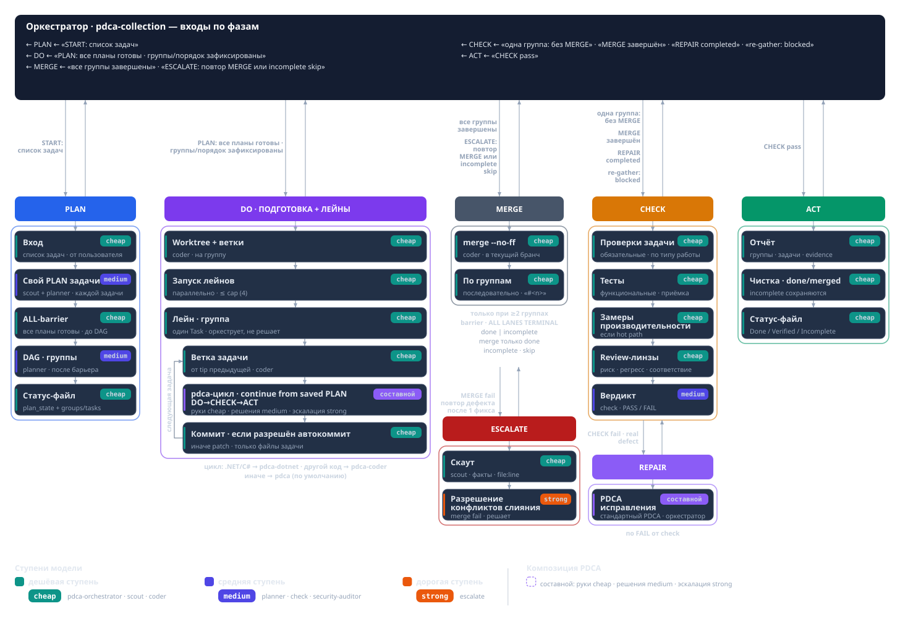
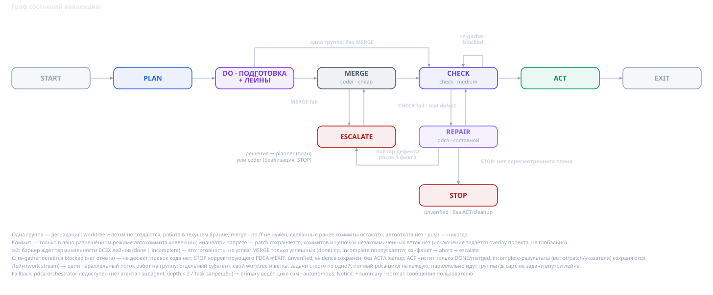

# Как сохранить контроль за кодом в эпоху ИИ

Агенты намного производительнее человека. В короткий промежуток времени они могут сгенерить очень много кода. Как это ни странно звучит, но требования к компетенциям инженера ИИ не падают, а возрастают. Современный разработчик в агентской среде испытывает большую нагрузку, чем без нее, так как ему необоходимо понимать все те бесконечные предложения, прототипы, классы, интерфейсы, тесты и проч. которыми его засыпает ИИ. Он должен уметь выбирать из множества вариантов, которые ему предлагаются, он должен понимать обоснование каждого решения и аспекта разработки. В противном случае, при отстутствии контроля над этим процессом, у человека скоро пропадает понимание о том, над чем он работает. Он теряет причастность к решению с технической точки зрения, хотя при этом остается ответственным за него. Возникает противоречие - с одной стороны куча чужого кода (местами не тривиального), с другой - ваша обязанность понимать, отвечать и владеть продуктом. 

Если все пустить на самотёк, то вы постоянно будете сталкиваться с PR на 500+ файлов, бранчами на тысячи коммитов и т.д. Единственный способ это переварить - взять другого агента, чтобы он делал ревью и прогонял тесты. В этом случае человек дейсвительно превращается в мясного прокси и теряет всякий контроль над проектом. Это плохо, если вы не фрилансер. Вам платят зарплату за ваш код, несмотрят на то, что его сгенерировала модель. Вы несете конечную ответственность за работоспособность решения. Раньше, когда код писался вручную, мы также отвечали за продукт, хотя имели очень ограниченный контроль над ним. Мы использовали фреймворки, библиотеки, автосгенеренный код, драйвера операционной сисемы в конце концов и другие чужие функциональные блоки, оставаясь ответственными за все решение целиком. Сейчас и код становится чужим, но владение над ним никуда не пропадает. Владеете им по прежнему вы.

В предыдущей статье я рассмотрел один из подходов, который позволяет иметь чуть больший контроль над реализацией. Он дает больше понимания и больше артефактов для человека чтобы не терять смысл выбранных решений. Скил, рассмотренный в предыдущей статье подходит для реализации понятной и ограниченной задачи, для которой можно подобрать проверяемые критерии приемки. Такие задачи могут быть сложны в реализации и объемны по времени, но с точки зрения аналитики не являются сложными. Как правило, такие задачи — это результат декомпозиции более комплексной задачи. Данная статья описывает подход для решения более сложных задач, где треботвания к пониманию и контролю возврастрают.  

## Что делать с большими задачами

Самый простой и прямолинейный способ - отдать задачу целиком агенту. Если у вас сильная модель, она может работать в таком режиме, слабые модели либо справятся с этим плохо, либо не справятся совсем, но даже если результат будет удовлетворительный, на выходе мы получим кучу кода, тестов, огромный PR с сотнями коммитов. Если вам не нужно изначально понимать что будет под капотом, то мы можем сказать модели: ну иди, напиши приложение, или, напиши игрушку, где будут летать самолетики и сбивать какие-нибудь шарики. И тогда действительно она напишет какую-то мега-игру с тысячами строк кода, с разными бэкендами, фронтендами, базами данных и так далее. Можно ли это будет запускать в прод и показывает заказчику не имея никакого контроля и понимания, что там внутри? Простой вайбкодинг на таких сложных задачах просто не работает.

Серьезный подход требует анализа и декомпозиции. Мы заранее нарезаем набор более мелких задач, которые имеют чёткие границы и определения и только потом отдаём на реализацию, которую можем делать всем списоком либо по отдельности. Это первый и обязательный шаг для сохранения контроля над проектом. Каждая задача должна быть проработана (прожарена) и документирована. Есть масса скилов, которые ускоряют и улучшают этот процесс, однако это за рамками нашей статьи. Рассматриваемые скилы относятся к процессу SDLC не вообще, а конкретно к этапу реализации.

## Зачем нужны скиллы

Большая задача по типу «Напиши там проект, где летают самолёты и что-то сбивают», на самом деле должна быть разбита на кучу других, более мелких подпроектов. Эти подпроекты должны быть разбиты на эпики, эти эпики должны быть разбиты на какие-то задачи, подзадачи и так далее. Всё это должно попасть в бэклог. И вот в таком случае мы будем чётко и точно знать, что же представляет из себя наш конечный продукт, как он будет работать, по крайней мере в первой версии.

Отправлной точкой разработки скилов PDCA-*, описанных ниже стало решение проблемы автономной работы над списоком тикетов из такого беклога. При наличии списка задач, довольно трудоёмко, долго и дорого реализовывать их по одному. В режиме промпта можно скормиь агенту этот список, однако почти наверняка агент встанет на середине работы по той или иной причине. Например, он может попросить подтверждение пользователя, артефакты предыдущей задачи могут остаться в ворктри, агент может не сообразить как скопмоновать задачи и выстроить зависимости и проч.

Вот как раз задачи из этого бэклога могут быть скормлены скиллу pdca-collection, и он отлично тогда будет по ним работать и выполнять реализацию по каждой конкретной задаче, со своими тестами, логами и со своим статусом.

Второй скил - pdca-incremental используется для менее определенных задач, где понимание объема и границ не четкое. Цель может быть измерима и однозначна, однако способы ее достижения пока не известны или зависят от слишком многих факторов, которые заранее расчитать не либо невозможно либо неоправдано дорого. Такие задачи мы не можем нарезать на подзадачи, нам известно только как можно начать ее делать, те. первые шаги, а дальше ход реализации будет зависеть от результатов этого первого шага и других вводных, которые мы получим в ходе реализации. 

Рассмотрим оба этих скила.

## PDCA Collection

Здесь используется так же концепция ролей и тиров, которая описана в предыдущей статье.

На вход скилу поступает набор задач в той или иной форме. Например, это может быть промпт "все открытые задачи в таком-то эпике" или "все открытые задачи в таком-то релизе", ссылка на список задач и так далее. Скилл не декомпозирует задачу на набор мелких. Он работает с уже заранее определенным списоком задач.

Разберем каждый из этапов скила по отдельности.

### Планирование

Первым делом скил запускает планирование с определенной степенью параллелизма для каждой из задач в списке. Планирование происходит в специальном субагенте - планер, который классифицирует эту задачу и пишет для неё критерии приёмки. 
Исходя из анализа сущности задач, драйвер выполняет их кластеризацию, то есть разбивает на независимые группы. Группа определяется тем, что ее задачи затрагивает одинаковые блоки кода и не могут выполняться параллельно. Напротив, задачи в разных группах как раз-таки могут выполняться параллельно. После кластеризации выполняется анализ зависимостей, который определяет последовательность выполнения задач внутри одной группы.

### Реализация

Если получилось более одной группы, то для каждой из них создается отдельный бранч и ворктри. Если все задачи выполняются последовательно в единственной группе, то работа происходит в текущем бранче и ворктри. Каждая группа может быть запущена параллельно. Степень параллелизма не определена, но как правило агент выбирает 2 или 4 параллельных выполнения.
Группа считается завершенной, если все задачи в ней завершены. Если хотя бы одна задача в группе завершена, но не выполнена (incomplete), группа считается incomplete. Если в группе нет невыполненных задач, она считается успешной. После завершения всех групп, начинается этап слияния успешных групп. Не успешные группы не сливаются и требуют отдельного ручного действия (как правило, перезапуск скила после завершения текущего). При слиянии групп может возникнуть конфликты, которые разрешаются через эскалацию.

### Интеграция

Каждая из задач группы имеет собственную реализацию и приемку. Но успешность отдельных задач не означает успешность всего списка. Нам необходимо скомпилировать результаты всех этих задач в один единый кусок кода и выполнить интегральную приемку всей коллекции. Хотя тестов для коллекции у нас нет и скил ничего не знает про ту большую задачу, из которой могла получится эта коллекция задач, но по крайней мере, мы должны убедится, что решение компилируется и все интеграционные тесты зеленые.

Интеграция связана со слиянием нескольких веток в Git или слиянием нескольких worktree. И, как правило, это самостоятельный, бывает, что очень сложный процесс. Так как, несмотря на изоляцию групп, всё равно возникают какие-то конфликты слияния, и нам необходимо, по сути, писать новый код, создавать, рождать новый код для того, чтобы всё компилировалось и всё работало как надо.

### Закрытие

После слияния всех груп и успешной интеграционной проверки, коллекция завершается с сохранением соответствующих артефактов и обновлением статус-файла.

Граф состояний скила описан ниже

## PDCA Incremental

То есть мы знаем критерии приёмки, однако что именно мы будем делать в процессе реализации этой задачи, нам неизвестно. И более того, каждый шаг в направлении цели является поводом для следующего цикла. То есть здесь мы тоже можем идти в цикле, в таком лупе, но входные данные для каждого из этих циклов получаются из выходных данных предыдущего цикла.

То есть мы инкрементально, шаг за шагом, медленно продвигаемся к цели без чёткого понимания вообще, что мы будем делать на следующем шаге. Единственное, что мы знаем, — это что мы будем делать на текущем шаге. И, соответственно, когда задача только ставится, мы знаем, что мы будем делать на первом шаге.

Соответственно, как этот скилл работает? Он запускает планирование при получении задачи, и на этапе планирования мы определяем метод, с помощью которого цель будет измеряться. То есть методика измерения цели определяется на этапе планирования, и тут же происходит, собственно, измерение этой метрики.

То есть если стоит задача, например, поднять тестовое покрытие до 75%, то первое, что нам нужно сделать, — это определиться с методикой измерения покрытия, а второе — нужно померить текущее значение этого покрытия. Если оно меньше, чем 75%, тогда, ну да, мы запускаем задачу и начинаем эту цифру доводить до целевой. Если она больше или равна, то, в принципе, на этом цикл и заканчивается. То есть скилл заканчивает работу и говорит, что цель уже достигнута.

Вот после определения методики и текущего показателя задача передаётся исполнителю, который продумывает и реализует один инкремент по поставленной цели. Если речь идёт, например, о покрытии, то он определяет, какие строчки кода не покрыты, и пишет для них тесты, энное количество тестов. После чего мы в CHECK замеряем новое значение по покрытию. И если оно достигло нашего показателя, в принципе, на этом работа цикла заканчивается. Если оно не достигло, то мы всё повторяем заново. И так до тех пор, пока не достигнем целевого показателя.

Вот. Или другой пример такой инкрементальной работы — это увеличение производительности. Например, мы говорим, что данный метод необходимо оптимизировать, чтобы количество аллокаций снизилось там на 15%. Мы не знаем заранее, какие действия нам нужно предпринять, чтобы снизить аллокации. У нас есть только примерные наброски того, что: ага, вот здесь аллоцируют массив, можно его попробовать заинлайнить или на стек положить, и тогда у нас не будет аллокации. Раз, давай-ка мы это попробуем. Вот это план на один шаг.

Но заранее мы не можем составить общий план, который точно нас приведёт к этой цели. Это вот такая интерактивная задача, которая должна шаг за шагом реализовываться. То есть вот этот скилл как раз для такого рода задач. Мы определяем узкое место, решаем его, фиксим его и опять производим замер. Если мы не в допуске по целевому показателю, то повторяем это действие ещё раз. И так повторяем их столько раз, пока не достигнем результата.

Сходимость этого процесса определяет планер на самом начальном этапе. То есть если планер видит, что это, в принципе, несходящийся процесс, то тогда цикл тоже заканчивается с результатом таким, что мы не можем достигнуть этого показателя.

Ну, это бывает так, что мы, допустим, поставили цель, чтобы у нас были и аллокации меньше, и время выполнения метода меньше. Но это противоречие. То есть когда у нас полностью оптимизированный код, как правило, это противоречащие друг другу цели: мы либо снижаем аллокации путём увеличения времени выполнения, либо снижаем время выполнения путём дополнительных аллокаций. Вот если мы видим, что цель не может быть достигнута, она несходящаяся, то цикл тоже завершается.

Это вот класс задач, при котором нам непонятен объём.

## Ещё раз об Incremental

Вот это что касается Collection. По поводу инкрементального скилла здесь ситуация другая. Здесь у нас как бы одна задача, вот, например, достижение какого-то показателя, достижение какой-то измеримой цели. Но она не декомпозирована, мы просто должны сесть и начать работать.

Вот путь длиной в тысячу миль начинается с первого шага. Мы просто знаем направление, у нас есть вектор движения, и мы просто должны идти по этому пути. И дорогу осилит идущий.

И здесь точно так же: может, действительно, нам понадобится очень много шагов, но если мы двигаемся в нужном нам направлении, то всё хорошо. Даже если у нас нет никакого плана, мы просто знаем свой следующий шаг. И, соответственно, после того как мы этот шаг сделали, то состояние, в котором мы очутились, является базой для следующего шага. И таким образом мы постепенно продвигаемся к цели, постепенно так или иначе приближаемся к реализации задачи.

## Заключение

Рассмотренные выше два скилла позволяют реализовывать комплексные задачи повышенной сложности, без потери контроля над реализацией. В процессе выполнения мы имеем определенный набор артефактов, предсказуемое поведение и четкие критерии завершения. Всё это существено повышает прозрачность и управляемость процесса разреботки.
