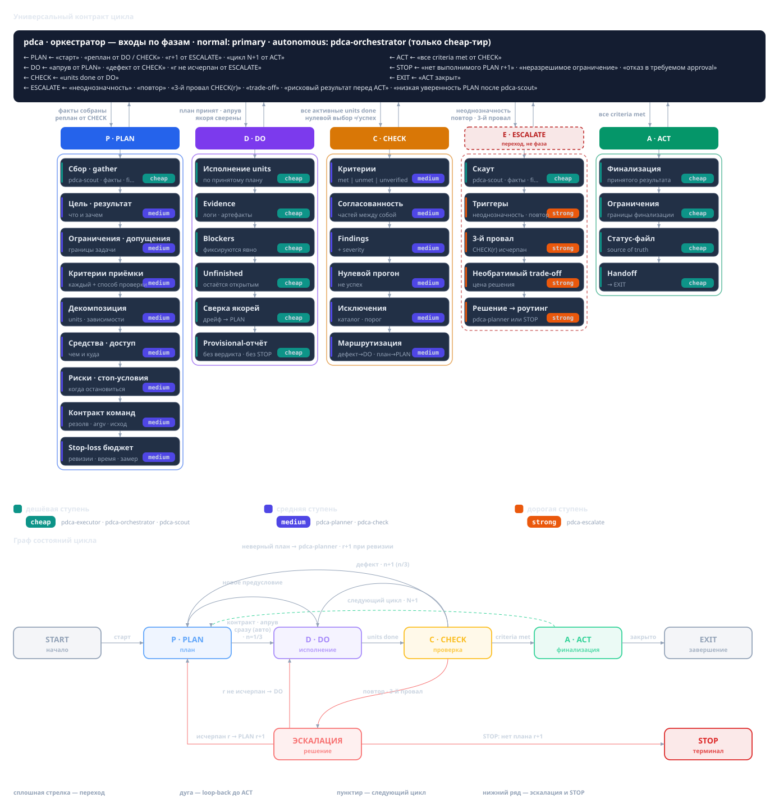

# `pdca`: цикл, который доводит задачу до проверяемого результата

## Зачем нужен цикл и когда выбирать `pdca`

Обычная работа ассистента — последовательность действий: прочитал, поправил, запустил, сказал
«готово». В ней три прорехи. Непонятно, что считалось успехом: критерий не сформулирован
заранее, и «готово» — самооценка автора, а не проверенный факт. Состояние живёт в контексте
сессии. После компакции (хост сжимает контекст) или в новой сессии ассистент не помнит, где он, что сделано и почему.
И ошибки не наказываются: неудача не мешает «попробовать ещё раз» тем же способом.

Скилл `pdca` заменяет последовательность на **путь к проверяемому результату**. Идея взята у
управленческого цикла Plan — Do — Check — Act: планируем, делаем, независимо проверяем,
завершаем — или возвращаемся к плану. В контракте это машина состояний с **гейтами**: гейт —
условие, при котором разрешён следующий шаг. Гейт проверяет **присутствие** нужных пунктов, а
не качество. Обещание скромное: цикл не гарантирует правильный результат в реальном мире, но не даёт
закрыть работу без проверки, молча потерять состояние или выдать однотипные повторы за
прогресс.



`pdca` — **доменно-нейтральный** скилл: он называет только **роли** и **фазы** и не навязывает
ни артефактов, ни типов задач, ни предметных примеров. Чем будет результат — отчётом,
документом, конфигурацией, планом — решает фаза планирования; она же выбирает способ проверки.
Поэтому `pdca` стоит выбирать для задачи с **проверяемым результатом**: заранее можно назвать
критерии успеха и способ их проверки.

Отдельно: `pdca` не включается сам собой — без явного вызова контракт не действует. И это не
единственный вариант: `pdca`, `pdca-coder` и `pdca-dotnet` — три варианта одного цикла с разным
уровнем конкретики, а `pdca-collection` стоит **над** циклом: он координирует несколько циклов
и не переопределяет машину состояний. `pdca` задаёт общее ядро, соседние варианты описаны в
соседних статьях. Если цикл запущен как PLAN задачи внутри коллекции, он останавливается на
границе **PLAN → DO** и возвращает управление коллекционному родителю как `plan_handoff` —
та же задача, те же `N`/`r`/`n`, DO не начинается.

## Как запустить: только явно и по имени

У `pdca` **нет собственного фразового триггера**. Его вызывают явно по имени — командой вида
`skill pdca`; этим он отличается от `pdca-coder` (фразы «по циклу», «через PDCA», «по pdca») и
`pdca-dotnet` (фраза «по pdca-dotnet»). Доменно-нейтральный `pdca` — «эталон» семейства: он
остаётся за тем, кто осознанно назвал его сам, и не переопределяет чужие триггеры.

## Кто делает какую работу

В цикле есть фиксированный набор **ролей**. Роль — это не человек и не конкретная модель, а
функция с правами. **Тир** (cheap / medium / strong) — ярлык стоимости и качества модели, а
**не** полномочие: дешёвая роль может иметь больше прав, чем дорогая. Конкретных
агентов и модели привязывает хост; скилл называет только роли.

| Роль | Что делает | Агент доменно-нейтрального `pdca` | Тир |
|---|---|---|---|
| GATHER — сбор фактов | Собирает указатели `file:line`, URL, числа; без рекомендаций | `scout` | cheap |
| PLAN — решения | Цель, критерии приёмки, декомпозиция, риски, способ проверки | `pdca-planner` | medium |
| DO — «руки» | Правит файлы, запускает команды, ведёт статус-файл (состояние цикла на диске) | `pdca-executor` | cheap |
| CHECK — вердикт | Независимо проверяет каждый критерий по фактическим свидетельствам | `pdca-check` | medium |
| ESCALATE | Второй тир для трудных решений | `pdca-escalate` | strong |
| RUNNER — оркестратор | Ведёт цикл, ничего не читая и не правя | `pdca-orchestrator` | cheap |

Несколько правил держат таблицу в рабочем состоянии. **Оркестратор — диспетчер, а не читатель и
не решающий**: он вызывает роли через `Task` и передаёт им отчёты друг друга, но сам не пишет
план, не читает файлы и не запускает команды; исключение — список задач (`todowrite`) как
оркестрация. **PLAN всегда за планировщиком**: и стартовый план, и пересмотр формулирует
`pdca-planner`. **Писать и запускать может только исполнитель**, включая статус-файл.
**Проверяющий независим от автора**: он судит по агрегированному отчёту со свежими прогонами и
фактами от `scout`, но может и **напрямую открыть артефакты доказательств цикла** — статус-файл
и манифест с их ссылками (scoped `read`), никогда сам продукт. Отсюда запрет на
саморедактирование, самочтение и самовердикт: исполнитель не выносит вердикт и не объявляет
STOP, проверяющий не проверяет собственную работу, оркестратор не подменяет роли.

Цикл ведёт **только `cheap-primary`** (primary — главная сессия) — по эффективному тиру профиля, а не по имени агента.
Medium/strong primary (например, `architect`) цикл не диспетчеризует. В автономном режиме
cheap-primary делегирует весь цикл cheap-агенту **`pdca-orchestrator`** через `Task`.
`pdca-orchestrator` — **не пятый скилл**, а агент-драйвер: он загружает выбранный вариант
(`pdca`, `pdca-coder` или `pdca-dotnet`) и ведёт один дочерний цикл либо одну группу коллекции.
Недоступная обязательная роль — **resource blocker**: в обычном режиме сообщают пользователю, в
автономном пишут `Notice:`; запрещённый хостом fallback не обходят. Если недоступен сам
`pdca-orchestrator`, в автономном режиме cheap-primary ведёт цикл сам (flat primary fallback) с
записью `Notice:`.

## Как идёт цикл

Машина состояний цикла выглядит так:

```text
PLAN → (normal: явный «go»/«го») → DO → CHECK → ACT → (EXIT | PLAN)
                    ▲                      │
                    └──────── DO → PLAN ───┘
```

Плюс отдельный терминальный путь **STOP** — ни «зелёный» гейт, ни успешный ACT.

**PLAN.** Планировщик восстанавливает цель по сути — «какой результат нужен», а не «какое
действие выполнить» — и возвращает обязательные поля: цель/ожидаемый результат, ограничения,
допущения, критерии приёмки **каждый со способом проверки**, декомпозицию с зависимостями или
явное решение не дробить, средства и доступ, риски и условия остановки. Пробел закрывается
фактом, явным допущением/риском либо блокером/эскалацией; молчаливая догадка запрещена.
Особый случай — критерий, чья проверка **зависит от состояния** (например, негативная ветка,
верная лишь из определённого предшествующего состояния): он обязан назвать **воспроизводимый**
источник доказательств, а решающий прогон показывают на заявленном baseline **ещё до гейта 1**;
недоказуемый критерий — это пробел (сообщить или переопределить оракул), а не пометка «готово».
И возврат после терминального `incomplete`/STOP — тоже вход PLAN: критерий, чьё доказательство
провалилось, нельзя перезапускать без изменений — либо показывают, что оно теперь получаемо,
либо переопределяют область.

**DO.** Исполнитель делает только то, что сказано в плане; изменение за пределами единицы —
«Over-Reach» — отдельная задача. Вердикт и STOP не его: он возвращает **предварительного
кандидата со свидетельствами**, и кандидат «результат достигнут» никогда не закрывает единицу —
вердикт принадлежит CHECK.

**CHECK.** Проверяющий судит каждый критерий по фактическим свидетельствам и проверяет
согласованность частей. Статусы: `met` (выполнен), `unmet` (не выполнен), `unverified` (не
проверен). Отсутствие проверки — не пропуск: без чисел и указателей критерий получает
`unverified`, а не `met`. На выходе — вердикт, матрица критериев, находки и маршрутизация:
дефект реализации → DO, неверный план → PLAN.

**ACT.** Завершает только результат, принятый текущим CHECK: фиксирует выводы, ограничения,
статус и передачу дел, финализирует статус-файл. Без ACT цикл не закрыть, а без принятой
проверки нет ACT; `rework`/`replan` — не часть ACT, а **возвраты до** него.

**Возвраты.** `CHECK → DO` — дефект реализации: исправить и проверить снова. `CHECK → PLAN` —
неверный план: планировщик выдаёт новую ревизию. `DO → PLAN` — новое предусловие или блокер: не
самовольный пересмотр, а кандидат на разбор планировщиком. **Аддитивное предусловие** (новая
активная единица, исходная остаётся `blocked` со своими критериями, маппинга нет) отличается от
**замены области** (настоящее вытеснение: `superseded` и обязательный маппинг «вытесненная →
замена» со всеми исходными критериями).

**Пять гейтов** разрешают переходы:

1. **План → DO:** все обязательные поля на месте, план записан в статус-файл, получен `go` —
   либо автономный режим.
2. **DO → CHECK:** все активные, не вытесненные единицы `done` со свидетельствами.
3. **CHECK → ACT:** все критерии `met` на фактических данных, ни одного `unmet`/`unverified`.
4. **ACT → EXIT:** результат и статус-файл финализированы.
5. **STOP:** отдельная финализация, вне ряда переходов выше.

Нерушимы два инварианта: **нельзя пропустить CHECK** и **нельзя закрыть цикл без ACT**.

Прогресс считают **три счётчика**. `N` — номер цикла задания в имени файла
`.pdca/status/<task>-<N>.md`; растёт только в ACT, когда планируется следующий цикл того же
задания. `r` — ревизия плана; растёт только при действительно другом плане. `n/3` — попытка
исполнения текущей ревизии: старт с 1, `CHECK → DO` увеличивает, новая ревизия сбрасывает в 1.
Отклонённый кандидат с неизменным планом — **не** ревизия: `r` и `n` не меняются; переименование
или сброс сессии ревизию не «производят». Рядом живёт **история дефектов** — по строке на
стабильный ключ дефекта (ревизии/попытки, число исправлений, указатели, исход эскалации); она не
стирается пересмотром или новой сессией. Счётчики и история живут в статус-файле. Они помогают
отличить «ещё одну попытку» от пересмотра и вовремя позвать эскалацию: **повтор того же дефекта
после одного исправления** — сигнал раньше, чем три разные неудачи; после третьего провала CHECK
одной ревизии четвёртой попытки нет.

**Режимы.** В **normal** режиме после записи плана оркестратор показывает его суть, даёт путь к
статус-файлу и просит написать `go` (или `го`) — **единственный** сигнал старта. «OK» без `go`
подтверждает, но не запускает; без `go` ничего не создаётся и не редактируется, кроме
статус-файла. В **autonomous** режиме тот же контракт идёт без пауз и вопросов: переходы — в тот
же ход, когда пройден гейт, ничего «для пользователя» не печатается, а уведомления (недоступная
роль, восстановление после компакции, допущение вместо вопроса) пишутся в статус-файл как
`Notice:`. Вопросов не задаётся: неразрешимое уводит в STOP.

**Память и доказательства.** **Статус-файл цикла** — источник истины по плану и прогрессу. Он
живёт на диске, переживает компакцию и новую сессию, и исполнитель обновляет его на каждом событии.
**Todo-список** в сайдбаре — лишь сессионное зеркало, теряющееся в новой сессии; он никогда не
источник истины. После компакции состояние восстанавливают из статус-файла (через `scout`), а не
по памяти. Цикл закрывается только на **свежих свидетельствах** — код выхода, числа, путь к
логу, `file:line`, — и никогда на утверждении, включая отчёты субагентов. Слова-маркеры
«должно работать», «вероятно» — сигнал назначить повторный прогон: **отчёт ≠ результат**.

DO и CHECK примиряет **замороженный манифест доказательств**: DO пишет его на границе
DO → CHECK и привязывает к зафиксированной идентичности результата (ревизия `r` плюс снятый
вход/артефакт), CHECK читает его **первым**. Дальше манифест только дополняют, не переписывают;
на каждый обязательный критерий в нём одна строка со статусом `met` / `open` / `na`, и **пока
хоть одна обязательная строка `open`, PASS не выносится**. Если в проекте есть валидатор
манифеста, его запускают. По умолчанию манифест и его логи живут в `.pdca/<task>/rv<k>/` — рядом
с каталогом статуса `.pdca/status/`.

## Учебная история: когда цикл останавливается

> Это **учебная иллюстрация**, а не источник правила. Она показывает переходы и STOP
> схематично; реальные формулировки и линии — в источниках в конце статьи.

Представим задачу: ответить, ускоряет ли кэширование промежуточных результатов ночной отчёт.
Планировщик в PLAN r1 формулирует критерии: (1) времена прогона с кэшем и без него на одном
наборе данных; (2) вывод следует из чисел; (3) методика воспроизводима. Единицы: базовый замер,
замер с кэшем, оформление вывода. План записан, пользователь пишет `go` — начинается DO
(`N=1`, `r=1`, `n=1`).

Во время DO исполнитель обнаруживает, что обещанного набора данных нужного объёма нет.
Самовольно чинить план нельзя: DO возвращает предварительного кандидата, и планировщик
классифицирует его как **аддитивное предусловие** — единица «замер с кэшем» остаётся активной,
но `blocked` на зависимости, и добавляется новая активная единица «получить набор данных». Это
не замена области, маппинг не нужен. Предусловие закрывается, замеры сняты, вывод оформлен,
DO → CHECK.

CHECK в ревизии r1 даёт по критерию «методика воспроизводима» `unmet`: числа есть, а методика
описана неполно. Это дефект реализации, цикл возвращается `CHECK → DO`, `n`=2. Исполнитель
дополняет описание; повторная проверка той же ревизии снова даёт `unmet` по тому же критерию.
Тот же дефект вернулся после одного исправления — сигнал **эскалации до второго исправления**,
и оркестратор зовёт `pdca-escalate`. Эскалация выясняет, что нужный набор данных в разрешённой
среде получить нельзя, а без него критерий не выполнить; пересмотренного плана, сохраняющего
исходный критерий, нет. Цикл заканчивается **STOP**: фиксируются оставшиеся
`unmet`/`unverified` критерии, счётчики (`N=1`, `r=1`, `n=2/3`) и история дефекта — **без
ложного PASS и успеха ACT**. Четвёртой попытки нет, и STOP её не обходит.

Этот исход — не провал дисциплины: цикл остановился там, где
исчерпался проверяемый результат, и сохранил запись почему. И это не «ещё немного
постараться»: правило «нет четвёртой попытки» действует и после эскалации.

## Ограничения и неверные ожидания

- **«Задача слишком простая для цикла».** Размер задачи не отменяет гейты: на «простых» задачах
  чаще всего переделывают. Отказ от дробления — решение планировщика внутри PLAN, а не
  освобождение от критериев и проверки.
- **Цикл ведёт только cheap-primary.** Medium/strong primary (например, `architect`) цикл не
  диспетчеризует; вне цикла он остаётся решающим.
- **Нет фразового триггера.** `pdca` не ловится на «по циклу» — это делает `pdca-coder`.
  Доменно-нейтральный вариант вызывается явно по имени, иначе контракт не действует.
- **Недоступная роль — не повод работать без неё.** Отсутствие обязательного агента — resource
  blocker: в обычном режиме сообщают, в автономном пишут `Notice:` и причину.
- **Гейт — это допуск, а не качество и не гарантия успеха.** Цикл не делает план правильным и
  не заменяет предметную экспертизу; он лишь не даёт закрыть работу без проверки.
- **Отчёт ≠ результат.** «Исполнитель сказал `done`» не закрывает единицу; нужны свежие
  свидетельства и независимый вердикт. Самопроверенный вердикт — «театр проверяющего».
- **STOP — не успех и не провал.** Отдельный терминальный исход без ложного PASS.
- **Статус-файл не удаляют.** Он финализируется и сохраняется в любом случае.

## Куда дальше

- Полный разбор всего семейства — гейты, счётчики, роли, режимы, память и доказательства —
  в путеводителе [`docs/articles/ru/pdca-guide.md`](pdca-guide.md).
- Нормативный контракт доменно-нейтрального цикла — файл скилла
  [`opencode/pdca/SKILL.md`](../../../opencode/pdca/SKILL.md).
- Инженерный цикл того же ядра для кода, тестов, документации и конфигурации — статья
  [`pdca-coder.md`](pdca-coder.md).
- .NET-специфичный вариант с собственными гейтами (ноль предупреждений, покрытие и мутации,
  обязательный test scope) — статья [`pdca-dotnet.md`](pdca-dotnet.md).
- Пакет независимых задач, разбитый на параллельные группы-лейны (барьер слияния,
  терминальный `incomplete`) — статья [`pdca-collection.md`](pdca-collection.md).

## Источники

Нормативные утверждения статьи сверены с репозиторием на коммите `065e2b8`; при расхождении
статьи и скилла приоритет у файла скилла. Карта «утверждение → источник»:

| Утверждение | Источник |
|---|---|
| `pdca` доменно-нейтрален: называет только роли и фазы; чем проверять — решает PLAN | `opencode/pdca/SKILL.md:6-14` |
| Роли, тиры, fallback; недоступная роль — resource blocker | `opencode/pdca/SKILL.md:38-88` |
| `pdca-orchestrator` — cheap-диспетчер, а не пятый скилл (промпт агента — в конфиге хоста, здесь не поставляется) | `opencode/pdca/SKILL.md:48-52,63-71` |
| CHECK видит артефакты доказательств цикла напрямую (scoped `read`), но не продукт | `opencode/pdca/SKILL.md:22-28,59`; `opencode/pdca/assets/agents/pdca-check.md:11-20,27-28` |
| Оркестратор-диспетчер; запрет саморедактирования/самочтения/самовердикта | `opencode/pdca/SKILL.md:89-118` |
| Машина состояний и ветка `DO → PLAN` | `opencode/pdca/SKILL.md:119-146` |
| Счётчики `N`, `r`, `n/3` и история дефектов | `opencode/pdca/SKILL.md:133-145` |
| Кандидат DO → PLAN; аддитивное предусловие vs замена области | `opencode/pdca/SKILL.md:186-201,264-273` |
| Гейты 1–5 и финализация STOP | `opencode/pdca/SKILL.md:203-242` |
| Фазовые контракты PLAN/DO/CHECK/ACT/STOP, критерий, зависящий от состояния, и возврат после `incomplete` | `opencode/pdca/SKILL.md:243-301` |
| Замороженный манифест доказательств и каталог `.pdca/<task>/rv<k>/` | `opencode/pdca/SKILL.md:302-324` |
| Режимы normal (`go`/`го`) и autonomous (`Notice:`, без вопросов) | `opencode/pdca/SKILL.md:327-351` |
| Коллекционный `plan_handoff` на границе PLAN → DO | `opencode/pdca/SKILL.md:343-350` |
| Статус-файл, todo-зеркало, доказательства, восстановление | `opencode/pdca/SKILL.md:146-184,368-391,392-408,410-436` |
| Эскалация, триггеры 1–5, правило «нет четвёртой попытки» | `opencode/pdca/SKILL.md:438-493` |
| Ограничения: права, инструкции, инъекции, секреты, авторизация | `opencode/pdca/SKILL.md:494-518` |
