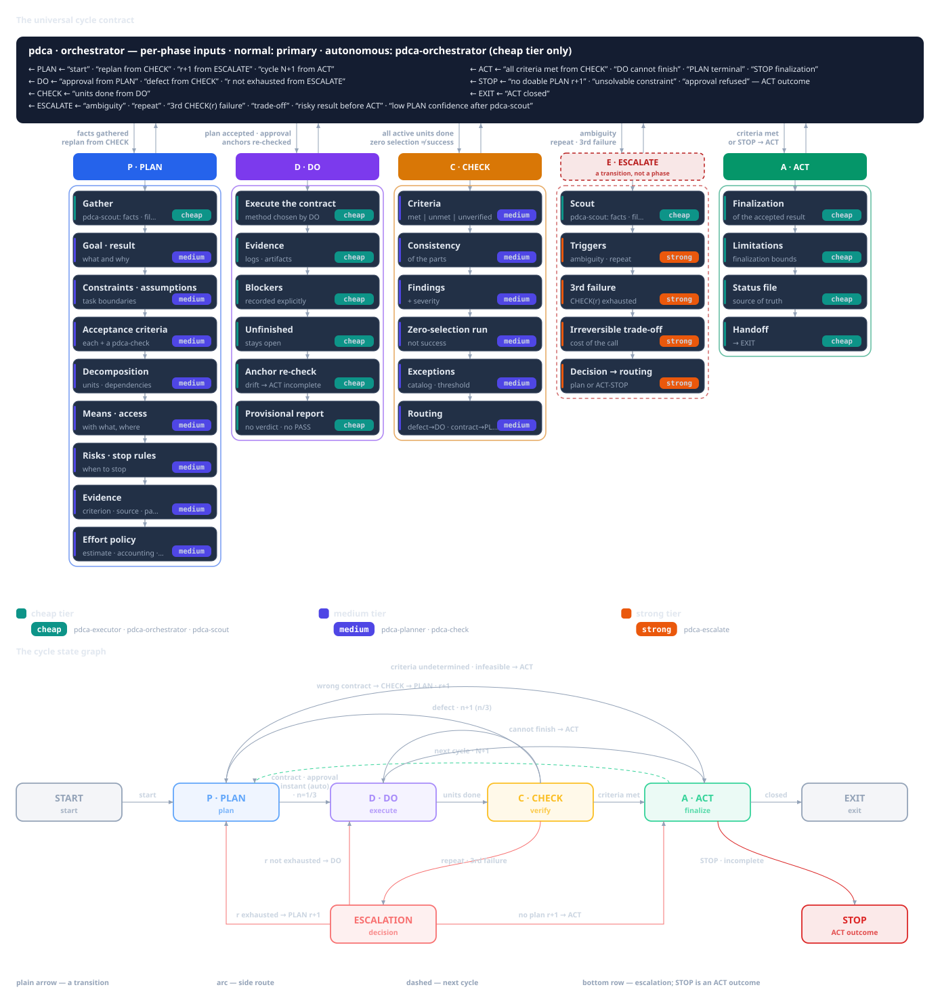

# `pdca`: the cycle that carries a task to a verifiable result

## Why the cycle exists and when to pick `pdca`

An assistant's ordinary work is a sequence of actions: read, fix, run, say "done". It has three
holes. It is unclear what counted as success: the criterion was not stated in advance, and "done"
is the author's self-assessment, not a verified fact. State lives in the session context. After
compaction (the host compresses the context) or in a new session the assistant does not remember
where it is, what was done and why. And mistakes go unpunished: a failure does not stop it from
"trying again" the same way.

The `pdca` skill replaces the sequence with a **path to a verifiable result**. The idea is borrowed
from the management cycle Plan — Do — Check — Act: plan, do, verify independently, finish — or
return to the plan. In the contract this is a state machine with **gates**: a gate is a condition
under which the next step is allowed. A gate checks the **presence** of the required items, not
quality. The promise is modest: the cycle does not guarantee the right result in the real world,
but it does not let you close work without verification, silently lose state, or pass off identical
retries as progress.



`pdca` is a **domain-neutral** skill: it names only **roles** and **phases** and imposes neither
artifacts, nor task types, nor domain examples. What the result will be — a report, a document, a
config, a plan — is decided by the planning phase; that phase also chooses the way to verify it.
So `pdca` is worth picking for a task with a **verifiable result**: you can name the success
criteria and the way to check them in advance.

Separately: `pdca` is the **only entry** of the family and does not turn itself on — for ordinary
tasks, without an invocation, the contract does not apply. It is not the only option in a second
sense: one PLAN inside `pdca` chooses the **form** — an ordinary cycle, an incremental campaign
(`pdca-incremental`) or a collection (`pdca-collection`) — and, when the work is code, the
**overlay** (`pdca-coder`, or `pdca-dotnet` inheriting it). The overlays add domain facts to the
chosen form and never form a second cycle; the forms and the overlays are described in the
neighbouring articles. If the cycle is launched as a collection item's PLAN, it stops at the
**PLAN → DO** boundary and returns control to the collection parent as a `plan_handoff` — same
task, same `N`/`r`/`n`, DO does not start.

## How to launch it: by phrase, or by name

`pdca` is caught by the phrases "by the cycle", "via PDCA", "run PDCA": the skill is the family's
single entry, and its one PLAN classifies the goal into a form and picks the overlay instead of
routing to a separate umbrella skill. Naming another skill explicitly (`pdca-dotnet`,
`pdca-collection`, …) is a constraint the PLAN works inside rather than re-routes. The domain-neutral
`pdca` stays the family's "reference": it does not redefine other skills' triggers.

## Who does what work

The cycle has a fixed set of **roles**. A role is not a person and not a specific model, but a
function with permissions. A **tier** (cheap / medium / strong) is a label for a model's cost and
quality, **not** an authority: a cheap role can have more permissions than an expensive one. The
host binds specific agents and models; the skill names only roles.

| Role | What it does | Agent of the domain-neutral `pdca` | Tier |
|---|---|---|---|
| GATHER — fact gathering | Collects `file:line` pointers, URLs, numbers; no recommendations | `pdca-scout` | cheap |
| PLAN — decisions | Goal, acceptance criteria, decomposition, risks, verification method | `pdca-planner` | medium |
| DO — hands | Edits files, runs commands, keeps the status file (the cycle's state on disk) | `pdca-executor` | cheap |
| CHECK — verdict | Independently verifies every criterion against actual evidence | `pdca-check` | medium |
| ESCALATE | The second tier for hard decisions | `pdca-escalate` | strong |
| RUNNER — orchestrator | Drives the cycle, reading and editing nothing | `pdca-orchestrator` | cheap |

A few rules keep the table working. **The orchestrator is a dispatcher, not a reader and not a
decision maker**: it dispatches the roles to subagents and passes their reports to one another, but it
does not write the plan, read files or run commands. **PLAN always belongs to the pdca-planner**: both
the initial plan and a revision are formulated by `pdca-planner`. **Only the executor may write
and run**, including the status file.
**The checker is independent of the author**: it judges by the aggregated report with fresh runs and
facts from `pdca-scout`, but it may also **open the cycle's evidence artifacts directly** — the status
file and the manifest with their pointers (scoped `read`), never the product itself. Hence the
prohibition on self-editing, self-reading and self-verdict: the executor does not render a verdict
and does not declare STOP, the checker does not verify its own work, the orchestrator does not
substitute for the roles.

The cycle is driven by the **cheap primary only** (the primary is the main session) — by the
profile's effective tier, not by the agent's name. A medium/strong primary (for example,
`architect`) does not dispatch the cycle. In autonomous mode the cheap primary delegates the whole
cycle to the cheap **`pdca-orchestrator`** agent. `pdca-orchestrator` is **not a
sixth skill** but a driver agent: it loads the execution contract of the decided form (`pdca`, plus
the form contract, plus the declared overlay) and runs one child cycle, one campaign or one
collection group. An unavailable mandatory role is a
**resource blocker**: in normal mode it is reported to the user, in autonomous mode it is written
as `Notice:`; a fallback forbidden by the host is not bypassed. If `pdca-orchestrator` itself is
unavailable, in autonomous mode the cheap primary drives the cycle itself (flat primary fallback)
and records a `Notice:`.

## How the cycle runs

The cycle's state machine looks like this:

```text
PLAN → (normal: the user approves the plan) → DO → CHECK → ACT → (EXIT | PLAN)
                    ▲                      │
                    └──────── DO → PLAN ───┘
```

Plus a separate terminal path, **STOP** — neither a "green" gate nor a successful ACT.

**Form and overlay before the phases.** The same PLAN also declares the **form** — an ordinary cycle
(the default, when the method and the volume are known and bounded), an incremental campaign
(`pdca-incremental`) or a collection (`pdca-collection`) — and, when the work is code, the **overlay**
(`pdca-coder`, or `pdca-dotnet` inheriting it). The form is not re-decided per step; the overlay adds
domain facts to the chosen form and never opens a second cycle. Its unit of progress is a **lens**: a
**probe** is a bounded action inside one step (no new PLAN, no CHECK owed), an **increment** is a
completed opening of the chosen part or question. Credit is a change of the result **or**
decision-relevant knowledge — a rejected candidate that yields such knowledge is credited as a
knowledge increment, so a numeric gain is a specialisation for measurable goals, not a universal
gate.

**PLAN.** The pdca-planner restores the goal by essence — "what result is needed", not "what action to
perform" — and returns the mandatory fields: goal/expected result, constraints, assumptions,
acceptance criteria **each with a way to verify it**, a decomposition with dependencies or an
explicit decision not to split, means and access, risks and stop conditions. A gap is closed with a
fact, an explicit assumption/risk, or a blocker/escalation; a silent guess is forbidden. A special
case is a criterion whose verification **depends on state** (for example, a negative branch that
holds only from a certain prior state): it must name a **reproducible** source of evidence, and the
decisive run is shown on the declared baseline **before gate 1**; an unprovable criterion is a gap
(report it or redefine the oracle), not a "done" mark. And a return after a terminal
`incomplete`/STOP is also a PLAN entry: a criterion whose evidence failed cannot be re-run
unchanged — either show that it is now obtainable, or redefine the scope.

**PLAN close.** A plan is not `ready` until its decisive commands are checked against the
environment: every identifier resolves to at least one target in the declared scope, the argument
vector survives the harness (no shell alias, redirection or unexpanded placeholder), the phase is
legal (a boundary-only sweep is not planned as inner work), the scope fits the declared budget, and
the expected outcome is declared as `green`, `expected-negative` or `informational`. A violation is
a **plan defect**: gate 1 fails and the pdca-planner revises. Gate 1 also fixes a **stop-loss
budget** — maximum revisions, wall clock and measurement time; its exhaustion routes to
`pdca-escalate`/STOP, never to an unplanned extra attempt. Planning depth follows risk: a small,
well-understood change gets a compact plan, and a measurable target whose mechanism is unproven
first gets a bounded probe, not a full acceptance contract.

**DO.** The executor does only what the plan says; a change beyond the unit is "Over-Reach" — a
separate task. The verdict and STOP are not its own: it returns a **preliminary candidate with
evidence**, and the candidate "the result is achieved" never closes the unit — the verdict belongs
to CHECK.

**CHECK.** The checker judges every criterion by actual evidence and checks the consistency of the
parts. Statuses: `met` (satisfied), `unmet` (not satisfied), `unverified` (not verified). A missing
check is not a pass: without numbers and pointers a criterion gets `unverified`, not `met`. The
output is a verdict, a criteria matrix, findings and routing: an implementation defect → DO, a
wrong plan → PLAN. The PLAN's **carrying claims** — the goal's central claims, mandatory criteria and
hard validity constraints, written separately from quality-rubric axes — carry a **veto**: a
`confirmed` or `unverified` finding against one forbids PASS and a final `done` at any rubric score.
Removing the block has exactly three paths: fix and re-check, objective refutation with evidence
reproduced by a non-author, or an explicit narrowing of the result inside the original goal recorded
as `limited`. Moving the finding to "the next step" does not remove the block.

**ACT.** It completes only a result accepted by the current CHECK: it records conclusions,
constraints, status and handover, and finalizes the status file. Without ACT the cycle cannot be
closed, and without an accepted check there is no ACT; `rework`/`replan` are not part of ACT but
**returns before** it.

**Returns.** `CHECK → DO` — an implementation defect: fix it and verify again. `CHECK → PLAN` — a
wrong plan: the pdca-planner issues a new revision. `DO → PLAN` — a new precondition or a blocker: not a
unilateral revision but a candidate for the pdca-planner to review. An **additive precondition** (a new
active unit, the original one stays `blocked` with its own criteria, no mapping) differs from a
**scope replacement** (a genuine supersession: `superseded` and a mandatory "superseded →
replacement" mapping covering all the original criteria).

**Five gates** permit the transitions:

1. **Plan → DO:** all mandatory fields are in place — including the declared **form and overlay** and
   the **carrying claims** with IDs — **every frozen command has passed the plan
   command contract**, the plan is written into the status file, a **stop-loss budget** is fixed,
   and the user **has approved the plan** — or autonomous mode.
2. **DO → CHECK:** all active, non-superseded units are `done` with evidence.
3. **CHECK → ACT:** all criteria are `met` on actual data, none `unmet`/`unverified`, and no carrying
   claim blocks the verdict.
4. **ACT → EXIT:** the result and the status file are finalized.
5. **STOP:** a separate finalization, outside the series of transitions above.

Two invariants are unbreakable: **CHECK cannot be skipped** and **the cycle cannot be closed
without ACT**.

These rules keep a green result honest. A run that selects **zero** targets is a failed run whatever
its exit status; exit `0` with nothing selected, executed or returned is not evidence. A decisive
negative arm is declared `expected-negative` with the exact expected failure identity and is `met`
on that observed outcome — never silently repeated until it turns green. A verdict may accept a
**recorded exception** only from a fixed catalog (environment/infrastructure, tooling
incompatibility, scope/resource policy, historical provenance), each naming its class, row,
evidence and substitute; a class appearing in **three or more units of one campaign** is a
systemic defect, filed and fixed rather than excepted a fourth time.

On DO entry the executor re-resolves every planned anchor before the first edit: **cosmetic drift**
(moved lines or declarations with the same identity) is a `Notice`; **semantic drift** (changed
footprint, contract, symbol or behavior) is DO → PLAN. A plan may not execute stale anchors, and
cosmetic drift may not manufacture a revision.

Progress is counted by **three counters**. `N` is the number of the task's cycle in the file name
`.pdca/status/<task>-<N>.md`; it grows only in ACT, when the next cycle of the same task is
planned. `r` is the plan revision; it grows only for a genuinely different plan. `n/3` is the
execution attempt of the current revision: it starts at 1, `CHECK → DO` increments it, a new
revision resets it to 1. A rejected candidate with an unchanged plan is **not** a revision: `r` and
`n` do not change; renaming or resetting the session does not "produce" a revision. Alongside lives
the **defect history** — one row per stable defect key (revisions/attempts, number of fixes,
pointers, escalation outcome); it is not erased by a revision or a new session. The counters and
the history live in the status file. They help tell "one more attempt" from a revision and call an
escalation in time: **the same defect returning after one fix** is a signal earlier than three
different failures; after the third failed CHECK of one revision there is no fourth attempt.

**Modes.** In **normal** mode, after the plan is written the orchestrator states that the **plan is
ready and recorded in the status file**, gives the path to it and asks you to **read the plan and
approve it** — the **only** start signal. A question, a request to change the plan or a
non-committal reply ("OK" without an approval) does not start; without an approval nothing is
created or edited except the status file. In **autonomous** mode the same contract runs without
pauses or questions: transitions
happen in the same turn in which the gate is passed, nothing "for the user" is printed, and
notifications (an unavailable role, recovery after compaction, an assumption instead of a question)
are written into the status file as `Notice:`. No questions are asked: the unresolvable leads to
STOP.

**Memory and evidence.** The **cycle status file** is the source of truth on the plan and progress.
It lives on disk, survives compaction and a new session, and the executor updates it on every
event. It is the **only** progress mirror: there is no separate todo or sidebar mirror, so a host
that provides no todo tool (V2 does) loses nothing, and a second mirror cannot diverge from it.
After compaction the state is restored from the status file (through
`pdca-scout`), not from memory. The cycle closes only on **fresh evidence** — an exit code, numbers, a
log path, `file:line` — and never on an assertion, including subagent reports. Marker words like
"should work", "probably" are a signal to schedule a re-run: **a report ≠ a result**.

DO and CHECK are reconciled by the **frozen evidence manifest**: DO writes it at the DO → CHECK
boundary and ties it to the fixed identity of the result (revision `r` plus the captured
input/artifact), and CHECK reads it **first**. Afterwards the manifest is only appended to, never
rewritten; every mandatory criterion has one row in it with the status `met` / `open` / `na`, and
**while even one mandatory row is `open` *and binding*, no PASS is rendered**. A self-imposed extra
*audit* row that follows from no agreed goal is not rewritten or deleted either: CHECK appends an
explicit disposition to it in the same manifest — a stable row ID and the classification
`diagnostic_nonbinding` with a reason — so the row may stay `open` while it is excluded from the
binding acceptance blockers, and the receipt shows binding unmet rows and audit notes separately.
The exclusion never covers a failing or missing required check, unverified direct evidence or a real
functional/security variant, and a finite audit task the user asked for **separately** stays
binding. If the project has a manifest validator, it is run. By default the manifest and its logs
live in `.pdca/<task>/rv<k>/` — next to the status directory `.pdca/status/`.

**One evidence location binding** applies: the evidence root and every manifest path are resolved
in the same checkout the checks run in. When the work happens in a secondary checkout, that
checkout is the binding root — the helper's repository argument names it and the evidence appears
at the identical repository-relative path there. There is no second "main-tree" form: a manifest
whose tree cannot be recomputed from its own `base_ref` is invalid, not an exception.

## A teaching story: when the cycle stops

> This is a **teaching illustration**, not a source of a rule. It shows the transitions and STOP
> schematically; the real wordings and lines are in the sources at the end of the article.

Imagine a task: answer whether caching intermediate results speeds up a nightly report. In PLAN r1
the pdca-planner formulates the criteria: (1) run times with and without the cache on the same data set;
(2) the conclusion follows from the numbers; (3) the methodology is reproducible. Units: the
baseline measurement, the measurement with the cache, writing up the conclusion. The plan is
written, the user approves the plan — DO begins (`N=1`, `r=1`, `n=1`).

During DO the executor discovers that the promised data set of the required size is not available.
It may not unilaterally fix the plan: DO returns a preliminary candidate, and the pdca-planner classifies
it as an **additive precondition** — the "measurement with the cache" unit stays active but
`blocked` on a dependency, and a new active unit, "obtain the data set", is added. This is not a
scope replacement, no mapping is needed. The precondition is closed, the measurements are taken,
the conclusion is written up, DO → CHECK.

CHECK in revision r1 returns `unmet` for the criterion "the methodology is reproducible": the
numbers are there, but the methodology is described incompletely. This is an implementation defect,
the cycle returns `CHECK → DO`, `n`=2. The executor expands the description; a re-check of the same
revision again returns `unmet` for the same criterion. The same defect came back after one fix — a
signal for **escalation before a second fix**, and the orchestrator calls `pdca-escalate`. The
escalation establishes that the required data set cannot be obtained in the permitted environment,
and without it the criterion cannot be met; there is no revised plan that preserves the original
criterion. The cycle ends in **STOP**: the remaining `unmet`/`unverified` criteria, the counters
(`N=1`, `r=1`, `n=2/3`) and the defect history are recorded — **without a false PASS and without a
successful ACT**. There is no fourth attempt, and STOP does not bypass that.

This outcome is not a failure of discipline: the cycle stopped where the verifiable result ran out,
and kept a record of why. And it is not "try a little harder": the "no fourth attempt" rule holds
after an escalation as well.

## Limitations and false expectations

- **"The task is too simple for the cycle."** The size of a task does not cancel the gates: it is
  on "simple" tasks that rework happens most often. Declining to split is a decision of the pdca-planner
  inside PLAN, not an exemption from criteria and verification.
- **Only a cheap primary drives the cycle.** A medium/strong primary (for example, `architect`)
  does not dispatch the cycle; outside the cycle it remains the decision maker.
- **The phrase triggers belong to `pdca` itself.** "By the cycle", "via PDCA", "run PDCA" load this
  skill — it is the family's single entry. Naming another skill explicitly (`pdca-dotnet`,
  `pdca-collection`, …) is a constraint the PLAN works inside. Without an invocation the contract
  does not apply.
- **An unavailable role is not a reason to work without it.** A missing mandatory agent is a
  resource blocker: in normal mode it is reported, in autonomous mode a `Notice:` and the reason
  are written.
- **A gate is an admission, not quality and not a guarantee of success.** The cycle does not make a
  plan correct and does not replace domain expertise; it merely does not let you close work without
  verification.
- **A report ≠ a result.** "The executor said `done`" does not close a unit; fresh evidence and an
  independent verdict are required. A self-verified verdict is "checker theater".
- **STOP is neither success nor failure.** A separate terminal outcome without a false PASS.
- **The status file is not deleted.** It is finalized and kept in any case.

## Where to go next

- A full walkthrough of the whole family — gates, counters, roles, modes, memory and evidence — is
  in the guide [`docs/pdca-guide.md`](pdca-guide.md).
- The normative contract of the domain-neutral cycle is the skill file
  [`skills/pdca/SKILL.md`](../skills/pdca/SKILL.md).
- The engineering **overlay** of the same core for code, tests, documentation and configuration is the
  article [`pdca-coder.md`](pdca-coder.md).
- The .NET **overlay** — it inherits `pdca-coder` — with its own gates (zero warnings, coverage and
  mutations, a mandatory test scope) is the article [`pdca-dotnet.md`](pdca-dotnet.md).
- A batch of independent goals split into parallel group lanes (a merge barrier, a terminal
  `incomplete`) is the **collection form**: [`pdca-collection.md`](pdca-collection.md).
- One goal without a known method or volume, advanced as credited steps, is the **incremental form**:
  [`pdca-incremental.md`](pdca-incremental.md).
- Host setup after installing a skill (role agents, the `pdca-orchestrator` runner, delegation depth,
  permissions, verification) is [`install.md`](install.md).

## Sources

The article's normative claims were reconciled with the repository's current files; where the
article and the skill disagree, the skill file takes precedence. Line ranges are kept only for the
short preamble before the first `##` heading. The "claim → source" map:

| Claim | Source |
|---|---|
| `pdca` is domain-neutral: it names only roles, phases and forms; what to verify with is decided by PLAN | `skills/pdca/SKILL.md:6-17` |
| `pdca` is the single entry: one PLAN decides the form and the overlay; no separate umbrella and no second PLAN | `skills/pdca/SKILL.md §Entry: one PLAN decides the form` |
| The three forms and how they differ | `skills/pdca/SKILL.md §Forms` |
| The overlays (`pdca-coder`, `pdca-dotnet` inheriting it) add differences, never a second cycle | `skills/pdca/SKILL.md §Overlays` |
| Lens: probe, increment, step and what counts as credit | `skills/pdca/SKILL.md §Lens: probe, increment and step` |
| Roles, tiers, fallback; an unavailable role is a resource blocker | `skills/pdca/SKILL.md §Roles and host requirements` |
| `pdca-orchestrator` is a cheap dispatcher, not a sixth skill; its prompt ships as `assets/opencode-agents/pdca-orchestrator.md` in every skill | `skills/pdca/SKILL.md §Roles and host requirements`; `skills/pdca/assets/opencode-agents/pdca-orchestrator.md` |
| CHECK sees the cycle's evidence artifacts directly (scoped `read`), but not the product | `skills/pdca/SKILL.md:19-24`; `skills/pdca/assets/opencode-agents/pdca-check.md:11-20,27-28` |
| The orchestrator is a dispatcher; the ban on self-editing/self-reading/self-verdict | `skills/pdca/SKILL.md §Roles and host requirements` |
| The cycle-control / campaign-control contexts and the campaign owner | `skills/pdca/SKILL.md §Control modes and the campaign owner` |
| The state machine and the `DO → PLAN` branch | `skills/pdca/SKILL.md §State machine and counters` |
| The counters `N`, `r`, `n/3` and the defect history | `skills/pdca/SKILL.md §State machine and counters` |
| The DO candidate → PLAN; an additive precondition vs a scope replacement | `skills/pdca/SKILL.md §DO → PLAN candidate · §Phase contracts (generic)` |
| Gates 1–5 and the STOP finalization | `skills/pdca/SKILL.md §Transition gates` |
| The carrying claims and the veto | `skills/pdca/SKILL.md §Claims and veto`; `skills/pdca/references/check.md §Carrying claims and the veto` |
| The plan command contract, vacuous and `expected-negative` runs, the exception catalog, DO-entry re-anchoring, proportional planning with a stop-loss budget, and one evidence location binding | `skills/pdca/references/plan.md §Plan command contract (PLAN close) · §Vacuous and expected-negative runs · §Recorded exceptions: catalog and repetition threshold · §Re-anchoring at DO entry · §Proportional planning and stop-loss · §One evidence location binding` |
| The PLAN/DO/CHECK/ACT/STOP phase contracts, a state-dependent criterion, and the return after `incomplete` | `skills/pdca/SKILL.md §Phase contracts (generic)` |
| The frozen evidence manifest and the `.pdca/<task>/rv<k>/` directory | `skills/pdca/references/plan.md §Frozen evidence manifest` |
| The normal (plan approval) and autonomous (`Notice:`, no questions) modes | `skills/pdca/SKILL.md §Control modes and the campaign owner · §Normal-mode approval` |
| The collection `plan_handoff` at the PLAN → DO boundary | `skills/pdca/SKILL.md §Normal-mode approval`; `skills/pdca-collection/SKILL.md §P — per-item PLANs, the barrier, clustering` |
| The status file as the only progress mirror, evidence, recovery | `skills/pdca/SKILL.md §Phase progress mirror · §Workspace and durable status · §Evidence over assertion · §Recovery` |
| Escalation, triggers 1–5, the "no fourth attempt" rule | `skills/pdca/SKILL.md §Escalation (pdca-escalate)` |
| Limitations: permissions, instructions, injections, secrets, authorization | `skills/pdca/SKILL.md §Generic operating constraints` |
