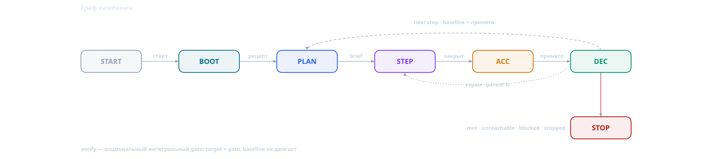

# `pdca-incremental`: кампания шагами, когда плана на весь объём нет

## 1. Проблема: цель есть, плана нет

PDCA-цикл предполагает, что задача известна целиком: её можно спланировать, сделать и
проверить. `pdca-collection` предполагает другое: список задач уже есть, их можно
разложить по группам и запустить параллельно. Но значительная часть реальной работы не
похожа ни на то, ни на другое.

Цель проверяема — «поднять покрытие до 75 %», «сократить аллокации вдвое», «убрать
N предупреждений», «закрыть класс дефектов», — а **путь неизвестен**: какие файлы,
узлы или классы дадут прирост, видно только после замера. Каждый следующий шаг зависит
от результата предыдущего, поэтому план на весь объём написать нельзя: он был бы
набором догадок.

Три наивных варианта и чем они плохи:

- **один большой цикл.** PLAN пишется вслепую; контракт нельзя проверить до конца;
  красный CHECK в финале стоит всей работы;
- **много циклов вручную.** Каждый цикл по отдельности корректен, но состояние кампании
  живёт в головах и разрозненных статусах: теряются отложенные ветви, блокеры,
  защищённые файлы и — главное — принятое число, от которого считается следующий шаг;
- **`pdca-collection`.** Её вход — известный список задач, а ALL-barrier требует
  настоящий PLAN каждой задачи **до** первого DO. Для исследовательской цепочки это
  планы-заглушки и фиксированный DAG, который не перераспределяется, когда шаг не
  добрал.

`pdca-incremental` — ответ на этот случай: **фиксированная единица инкремента,
rolling-выбор цели, цепочка принятых измерений и один статус-файл кампании**. Плана на весь
объём нет; есть план на следующий шаг и правило, как он выбирается. Планы отдельных задач
могут быть готовы заранее («прожарены») — кампания не собирает из них общий DAG и не
обязана выполнять их в заранее объявленном порядке.

### 1.1 Декомпозиция: заранее или по ходу

`pdca-collection` — не синоним декомпозиции. Коллекция предполагает, что декомпозиция
**уже сделана**: список задач известен, их footprint'ы не пересекаются, и все задачи можно
спланировать до первого DO. Инкрементальная кампания декомпозицию не отменяет — она
переносит её момент: цель дробится на шаги **по ходу**, и следующий шаг выбирается по
результату предыдущего замера.

Это разные режимы планирования, а не «с коллекцией и без»:

| признак | `pdca-collection` | `pdca-incremental` |
| --- | --- | --- |
| декомпозиция | вход: список задач известен до старта | выход: шаг выбирается после замера |
| план | все задачи сразу, ALL-barrier | только текущий шаг |
| единица | задача с независимым footprint | инкремент: цель + флор + замер |
| следующий шаг | из плана | из результата предыдущего замера |
| провал | group-stop, остальные не выполняются | `repair` одного шага, кампания продолжается |
| параллелизм | да, при ≥2 непересекающихся footprint | нет, последовательно по природе |

Это не движение наугад: у каждого шага есть цель, флор и зачётный замер, а следующий шаг
не начинается без принятого числа предыдущего.

Для метрики вроде покрытия декомпозиция «заранее» ненадёжна: множество непокрытых ветвей
меняется после каждого добавленного теста, маржинальная доходность кластера неизвестна до
замера, а знаменатель может сдвинуться. Поэтому план на десять шагов вперёд был бы набором
догадок; честнее зафиксировать единицу инкремента, флор и рецепт замера, а цели открывать
по свежей карте разрыва. Историческая проверка этого различения — в §5.6.

## 2. Когда выбирать

Выбирайте `pdca-incremental`, если цель — проверяемый предикат (число, множество,
бинарный признак) с **рецептом замера** и верно хотя бы одно из перечисленного:

- путь к цели не известен и открывается измерением;
- шаги информационно зависимы: цель шага N+1 осмысленна только после результата шага N;
- работа длинная: один цикл не покроет объём, а параллельные лейны дублировали бы цели;
- есть очередь прожаренных задач, но их порядок/состав зависит от предыдущего замера
  (общий footprint или общая метрика): каждая задача становится шагом, а не пунктом
  фиксированного DAG.

| ситуация | что использовать |
| --- | --- |
| план на весь объём известен и это одна задача | один цикл: [`pdca-dotnet.md`](pdca-dotnet.md), [`pdca-coder.md`](pdca-coder.md), [`pdca.md`](pdca.md) |
| известен список задач **и есть ≥2 непересекающихся footprint** | [`pdca-collection.md`](pdca-collection.md): группы, worktree, merge |
| известен список, но footprint один / цепочка / одна общая метрика | **`pdca-incremental`** (шаг = задача); если цели разные — базовые циклы |
| цель есть, плана нет, шаг определяется замером | **`pdca-incremental`** |
| цель не проверяема | сначала дизайн/`brainstorming`, не кампания |

Ключевой признак, разводящий с коллекцией, — **не количество целей и не известность
списка**, а доказанный параллелизм. Коллекция выбирается только когда есть ≥2
непересекающихся footprint. Если footprint один, задачи образуют цепочку или цель —
общая измеряемая метрика, известный список идёт через incremental: шаг = задача, план
задачи может быть готов заранее, но общий DAG не фиксируется. Известный список сам по
себе коллекцию не выбирает.

## 3. Контракт кампании

Кампания не переопределяет базовый цикл: машина состояний, гейты, роли, счётчики
`N`/`r`/`n` и loop-back берутся из базы. Она добавляет восемь инвариантов:

1. **Цель и рецепт замера зафиксированы на старте** — предикат, единица, знаменатель,
   фильтры исключений и порог записываются дословно. Их изменение по ходу — смена цели,
   то есть новая кампания с новым baseline.
2. **Одна единица инкремента на всю кампанию** — «один принятый прирост», а не файл,
   тест или день. Внутри шага работа дробится на кластеры, но шаг принимается целиком.
3. **Флор инкремента (floor)** — минимальный прирост, ради которого стоит платить за полный цикл.
   Цель шага = принятый baseline + флор; флор — нижняя граница, не потолок.
4. **Цепочка baseline** — вход шага N+1 только принятое число шага N. Нет принятого
   числа — нет следующего шага.
5. **Один зачётный замер на шаг** — красный результат не переснимают «на удачу»;
   замена допустима лишь при объективной невалидности и архивируется.
6. **Цели открываются, а не планируются заранее** — сначала свежая карта разрыва, затем
   отбор по ожидаемому выходу с учётом блокеров, отложенного реестра и protected.
7. **Состояние переезжает** — отложенные строки с триггерами, blocked arms, тикеты,
   защищённые участки и бюджеты живут в одном статус-файле и передаются каждому шагу.
8. **Один шаг за раз и неподвижный порог** — параллельные инкременты ломают цепочку;
   снижение порога, смена фильтра или удаление тестов не закрывают кампанию.

**Статус-файл кампании** — единственный источник состояния: `Goal`, `Recipe`, `Floor`,
таблица шагов (`kind`, `parent`, `baseline → target → accepted → delta`), `Current step`,
`Next-step seed`, `Deferred` с триггерами, `Blockers`, `Protected/foreign`, `Tickets`,
`Stop verdict`. Таблица шагов append-only; при расхождении статуса и evidence приоритет
у evidence.

Шаги бывают трёх видов: `increment` (обычный прирост), `repair` (новый цикл на тот же
target после непринятого шага, `parent = N`) и `verify` (интегральный гейт без прироста).
Подробнее — §4.2.

**Остановка** — явная, с записанным остатком:

| статус | смысл |
| --- | --- |
| `met` | предикат истинен на принятом замере; единственный успех |
| `unreachable` | остаток доказан числами по каждому кластеру и перераспределён |
| `blocked` | внешний блокер: тикет, среда, доступ |
| `stopped` | бюджет, лимит или остановка пользователем; остаток сохранён для продолжения |

### 3.1 Роли, тиры и полномочия

Блоки кампании — не анонимные шаги: у каждого есть роль-владелец, тир и полномочия.
Скилл называет роли; привязку к агентам и моделям даёт хост через `agent`-блок профиля,
model id в скилле нет. Тиры кампании: **cheap** — исполнение и факты, **medium** —
решения и вердикт. **strong** (`pdca-escalate`) — не роль кампании: его вызывает вариант
цикла внутри шага по триггерам, кампания получает только результат.

| блок | роль | тир | полномочия | выход |
| --- | --- | --- | --- | --- |
| BOOTSTRAP — решение | `pdca-planner` | medium | read-only, без делегирования | цель, рецепт, единица, флор, target |
| BOOTSTRAP — baseline | `pdca-executor` | cheap | edit/bash в разрешённой поверхности | точная дробь baseline |
| DISCOVER | `pdca-scout` | cheap | read-only: код, артефакты замера, git | карта разрыва, ranked seed |
| BRIEF | `pdca-planner` | medium | read-only, без делегирования | шесть блоков задания |
| STEP N | `pdca-orchestrator` | cheap | dispatch-only; внутри — роли варианта (pdca-planner/pdca-check — medium, pdca-executor — cheap, escalate — strong по триггерам) | отчёт шага + evidence |
| ACCEPT | `pdca-check` | medium | read-only + evidence шага | вердикт по строкам, зачётное число |
| DECIDE | `pdca-planner` | medium | read-only | next seed, перераспределение или стоп |
| ACT/STOP | `pdca-executor` + primary | cheap | pdca-executor: статус/доки; primary: только статус-файл | закрытая запись кампании |

Правила: primary не правит продукт (его файл — статус-файл кампании); pdca-planner не исполняет
и не делегирует; check не правит и судит по evidence; pdca-scout не рекомендует; orchestrator
не пишет код; escalate (strong) — внутри шага и только решает. Отсутствие роли — resource blocker;
flat-primary fallback помечается `Notice:`.

## 4. Как это работает

*Схема: `opencode/pdca-incremental/assets/diagram/incremental-state-dark.svg`; полная
раскладка с ролями и тирами — `incremental-contract-dark.svg`. Нижняя пунктирная петля
`DEC → STEP` — это `repair`; сноска внизу — опциональный `verify`.*

- **Bootstrap** — `pdca-planner` фиксирует цель, рецепт, единицу, флор и target; `pdca-executor`
  снимает baseline тем же рецептом, которым будут приниматься шаги.
- **Discovery + Brief — одна фаза PLAN с двумя владельцами.** `pdca-scout` поставляет факты
  (ranked-список целей), `pdca-planner` собирает шесть блоков: goal, current state, hard
  constraints, scope, acceptance, targets. Discovery сам по себе — не план шага: решение
  принимает pdca-planner. Разделение нужно не для фаз, а для полномочий и артефактов.
- **STEP N** исполняет `pdca-orchestrator`, но вариант шага выбирает кампания
  (`.NET` → `pdca-dotnet`, код → `pdca-coder`, иначе `pdca`) и передаёт его как
  `selected_variant`; драйвер не классифицирует задачу. Кампания не вмешивается в
  гейты шага и не принимает число за CHECK.
- **ACCEPT** — `pdca-check` выносит вердикт и зачётное число; primary дописывает строку в
  таблицу и переносит состояние.
- **DECIDE** — `pdca-planner` проверяет условие остановки и выбирает next seed; статус
  фиксирует primary. Недобор флора — loop-back внутри шага (новая ревизия плана), а не
  «следующий шаг с недобором»; исчерпание ревизий — эскалация или остановка с остатком.

**ACCEPT и DECIDE не сливаются**, в отличие от DISCOVER + BRIEF: это CHECK и ACT, а не
две половины одной фазы. ACCEPT — независимый вердикт по evidence и зачётное число;
DECIDE — маршрут кампании. Слить их значит позволить проверяющему выбирать маршрут и
смешать «шаг не принят» с «шаг принят, но кампания остановлена». Между ними фиксируется
принятое число, от которого считается следующий шаг.

### 4.1 Почему в брифе шесть блоков

Шесть — **проверенный минимум, а не фиксированный формат**: столько блоков выдержало
десять шагов кампании, не переоткрывая закрытое и не расползаясь по скоупу. Каждый блок
отвечает на свой вопрос и закрывает свой тип провала.

| блок | вопрос | какой провал предотвращает |
| --- | --- | --- |
| `GOAL` | что считается успехом и где шаг в цепочке `baseline → target` | локальная оптимизация, дрейф цели |
| `CURRENT STATE` | точные числа и состав последнего принятого прогона | план по устаревшим или «примерно» числам |
| `HARD CONSTRAINTS` | пороги, разрешённая поверхность, protected, запрет commit | подмена порога, чужие правки, выход за скоуп |
| `SCOPE` | проекты, селекторы, стражи, рецепт замера | шаг, который делает не то или не исполняет живую СУБД |
| `ACCEPTANCE` | флор, один зачётный замер, список провалов | самооценка, пересъёмка красного, прогноз как «измерено» |
| `TARGETS` | seed-кластеры с `file:line` и явное «что вне шага» | расползание скоупа и повторное открытие закрытого |

**Почему не меньше.** Слить `ACCEPTANCE` со `SCOPE` — потерять список «что считается
провалом», а это главное, что мешает подогнать результат. Слить `HARD CONSTRAINTS` с
`GOAL` — растворить инварианты в цели.

**Почему не больше.** Остальное уже задано скиллом и базовым контрактом: роли, тиры,
evidence-пути, поля статус-файла, порядок PLAN → DO → CHECK → ACT. Дублировать это в
брифе — шум. Детали плана (какие именно тесты и в каком порядке) — работа `pdca-planner`
внутри шага; если бриф начнёт их описывать, он превратится в план и отнимет у pdca-planner
решение.

Проектный оверлей может **расширять** блоки (например, добавить раздел безопасности
внутрь `HARD CONSTRAINTS`), но не сокращать: это нижняя граница.

**Сайзинг последнего шага.** Когда остаток сравним с флором (≲ 2×floor), шаг планируется
на весь остаток. Если он не добрал — одна ревизия внутри шага либо ещё один шаг, но цель
остаётся остатком, а не «флор, потому что так проще». Число шагов не планируется: оно
получается из остатка и фактических дельт.

**Экономика.** Флор существует потому, что у шага есть фиксированная цена: полный прогон,
evidence, ревью, обновление статус-файла. Слишком крупный шаг тоже плох: его план пишется
вслепую, а провал дороже. Ориентир — шаг, который реально добрать за одну-две ревизии.

**Автономный режим.** Дешёвый primary делегирует один шаг `pdca-orchestrator` и
пересказывает отчёт; между шагами нет паузы на апрув, пока не сработает условие
остановки. Если оркестратор недоступен, flat-primary ведёт шаг сам и помечает это
строкой `Notice:`.

### 4.2 Repair, verify и маршрут после шага

**Repair** — это не «ещё одна попытка» и не ревизия внутри шага. Ревизия `r+1` живёт в
том же цикле и не создаёт строку в статусе. `repair` открывается, когда `increment` уже
закрыт `not accepted` (внутренний `incomplete`/STOP; исчерпаны ревизии/попытки или нужен
другой подход), и создаёт новую строку `kind = repair`, `parent = N`:

- target, рецепт и порог те же; смена цели — новая кампания;
- старый шаг остаётся `not accepted`, красный замер сохраняется;
- один repair на провальный шаг; повторный провал — `pdca-escalate` или `unreachable`;
- повтор того же дефекта после одного фикса — `pdca-escalate` до второго фикса.

**Verify** — интегральный гейт кампании, аналог collection C, но не отдельный контракт:
не даёт прироста и не двигает baseline, в таблице `target = gate`, `accepted = pass/fail`.
Он гоняет полный гейт кампании на текущем принятом состоянии. Место фиксируется на
bootstrap: финал кампании или каждые K шагов. Провал открывает `repair` затронутых целей
или `blocked`, но не снижает порог. `verify` не заменяет ACCEPT шага: числа шагов
остаются источником истины.

**Маршрут после шага.** `accepted` → `next` или `verify` на чекпойнте. `not accepted`,
но цель ещё достижима → `repair`. `not accepted` и цель доказанно недостижима →
`unreachable` с evidence и переход к следующему target (если кампания допускает
независимые цели) либо `stop`. Внешний блокер → `blocked`. Провал шага не закрывает
остальные шаги: group-stop в кампании нет, blast radius = один шаг.

Это и есть ответ на десять прожаренных задач **с одной кампанийной целью** (покрытие,
перф, чистка): каждая становится шагом `increment` со своим планом, провал одной открывает
`repair` только для неё, а в конце при необходимости запускается `verify` по интегральному
дереву. Общего ALL-barrier и group-stop здесь нет. Если у десяти задач десять разных
целей — это не одна кампания, а десять базовых циклов (или collection, если есть ≥2
непересекающихся footprint).

## 5. Реальный кейс: кампания покрытия в nextorm (октябрь 2026)

> Ниже — **настоящий прогон**, а не учебный пример: десять автономных циклов одной задачи,
> одна метрика и ни одного worktree. Он показывает, как .NET-вариант ведёт длинную серию,
> где каждый следующий план опирается на измерение предыдущего, и почему её вели цепочкой
> циклов, а не коллекцией.

### 5.1 Постановка

Пользователь сформулировал задачу так (цитаты из переписки, сокращённо):

> «интеграционные тесты должны использовать реальную СУБД; если в тесте она не
> используется — это юнит тест», «inmemory переносим в юнит тесты», «тесты ядра
> допускается делать в интеграционных тестах только на одном провайдере, например
> sqlite», «75 % branch покрытие по интеграционным тестам», «на каждый дефект заводи
> тикет в rc4», «меня не спрашивай — работай в автономном режиме».

Из этого PLAN собрал проверяемый контракт:

- **цель** — довести branch-покрытие отдельного интеграционного гейта до жёстких 75 %
  (`MIN_INTEGRATION_BRANCH_COVERAGE`), порог снижать нельзя;
- **знаменатель** — только интеграционный прогон: `reportgenerator` по cobertura,
  `NextORM.Core.InMemory*` исключён политикой (in-memory — юнит-тесты), поэтому literal
  38 407 и counted 38 317 расходятся на 90 branch points;
- **легальность** — каждый добавленный факт исполняет живая СУБД (контейнерный провайдер
  либо файловый SQLite), ядровые факты — один SQLite-контекст; SQL-текст без исполнения не
  считается покрытием;
- **побочный выход** — каждый дефект продукта получает минимальное репро и тикет в
  milestone `1.0.9-rc4`; дубль комментируется, а не создаётся заново;
- **режим** — автономный: без вопросов и пауз на утверждение плана.

Старт кампании: **24 828 / 38 281 = 64.8 %** branch, гейт красный. Финиш:
**28 926 / 38 317 = 75.49 %** counted (literal 75.48 %), гейт зелёный.

### 5.2 Как подтянулся скилл

Задача — .NET (xunit v3, Testcontainers, `dotnet-coverage`), поэтому выбран вариант
`pdca-dotnet`, а не `pdca-coder` и не доменно-нейтральный `pdca`. Поверх него включён
проектный оверлей `nextorm-pdca`: регистры, тулчейн, перф-приёмка cached path и гигиена
планов. Оверлей не расширяет гейты базового контракта — он добавляет проектную специфику
аудита.

В автономном режиме дешёвый primary не ведёт цикл сам: он **делегирует один цикл**
субагенту `pdca-orchestrator` и передаёт в брифе вариант, цель, состояние, ограничения,
скоуп и критерии приёмки. Оркестратор сам проходит PLAN → DO → CHECK → ACT, пишет
статус-файл и возвращает сжатый отчёт; primary только запускает следующий цикл и
пересказывает результат, не спрашивая пользователя. Отсюда «десять циклов» — это десять
делегирований, а не десять ручных запусков.

`pdca-collection` в кампании **не вызывался ни разу**: его вход — пакет задач или
milestone с независимыми пунктами, а здесь была одна задача с одной числовой метрикой.
Подробный разбор границы применимости — в §5.6.

### 5.3 Как скилл разбил задачу

Ключевое решение: **единица декомпозиции — шаг измерения, а не файл и не фича**. Один цикл
= один прирост покрытия с собственным контрактом и собственной приёмкой. Внутри цикла
кластеры нарезаны по подсистемам, но цикл остаётся неделимым для зачёта.

PLAN каждого цикла содержит:

- **baseline** — принятое число предыдущего цикла (не «примерно», а точная дробь);
- **floor** — флор прироста, +250 counted-ветвей; target = baseline + floor;
- **кластеры** — например, в цикле 10 их было 14 (`SqlBuilder`, `MergeBuilder`,
  `QueryPreparer`, диалекты, трансляторы, рендеринг, коррелированные запросы), у каждого
  публичный маршрут, оценка ветвей и способ закрытия (факт + живой контроль);
- **контракт** — блоки `REQ-COV`/`REQ-LIVE`/`REQ-QUALITY`/`REQ-BOUNDARY`/`REQ-DOCS`/
  `REQ-DEFECTS`/`REQ-STATE` с явными негативными исходами: 28 737 вместо 28 738 — провал;
  дрейф знаменателя — провал; прогноз, зачтённый как измерение, — провал; второй удачный
  прогон, выбранный «чтобы число было красивее», — провал;
- **отложенный реестр** — ветви, которые сейчас недостижимы, с триггером переоткрытия
  (новая публичная ручка, снятый блокер, изменившаяся инструментация), а не «забыли»;
- **evidence-план** — где лежат логи, счётчики, хеши и записи проверки.

Флор +250 задан как минимальная цена шага: один boundary-прогон со всеми контейнерами и
evidence стоит несколько минут, и шаг меньше ~250 не окупает накладных расходов. По факту
циклы давали от +277 до +897, то есть флор ни разу не стал потолком.

Оценки ветвей в таблице кластеров — **дисконтированные прогнозы**, они никогда не
зачитываются как результат. В цикле 10 r1 оценивал 770 cobertura-ветвей (потолок ~989
counted), но зачёт дал лишь 28 427 (+398) — меньше цели 28 738; поэтому pdca-planner сделал r2
с пятью новыми кластерами (~299 cobertura / ~384 counted), и гейт закрыло только измерение
r2.

Разбиение включает и **легальный loop-back**: если прирост не добрал флор, PLAN делает
ревизию r2 с новой аллокацией, а не «просит DO постараться». Так случилось в цикле 6
(r1 дал +240 при поле 250) и в цикле 10 (r1 дал 28 427 при цели 28 738 — pdca-planner
перераспределил пять кластеров, r2 дал 28 926).

### 5.4 Как он это вёл

Один цикл выглядит так:

1. **PLAN r1** — зафиксировать baseline, флор, target, кластеры, контракт rv1, реестр
   отложенного, evidence-пути;
2. **DO** — `pdca-executor` пишет факты кластер за кластером: сначала узкий SQLite-only внутренний
   прогон (`NEXTORM_SKIP_PROVIDERS=...`), затем контейнерные провайдеры; сборка обязана
   быть 0 warnings / 0 errors;
3. **freeze** — после последней правки тестов содержимое замораживается (хеши), дальше
   тесты не меняются;
4. **BOUNDARY** — ровно один зачётный полный прогон под `dotnet-coverage` + отчёт
   `reportgenerator` с исключением `NextORM.Core.InMemory*`;
5. **CHECK** — отдельная роль проверяет контракт построчно по evidence, а не по рассказу
   автора; у неё ограниченный бюджет на до-сбор фактов и нет права править тесты;
6. **PASS → ACT** либо **loop-back в PLAN** с точной проваленной строкой контракта.

Дисциплина, которая удержала кампанию:

- **один зачётный прогон.** Красный результат не переснимают «на удачу»: цикл 10 r1
  (28 427) остался в истории как красный, и вместо повторного прогона pdca-planner сделал r2;
  попытки границы с флейками архивируются, зачитывается только зелёная;
- **чужие правки — protected.** Незакоммиченные `src/**` параллельной сессии
  фиксировались по sha256 на PLAN и проверялись на CHECK; их покрытие исключалось из
  зачёта, а дрейф знаменателя (38 281 → 38 317) объяснялся отдельно;
- **экология ≠ дефект.** Таймауты ClickHouse `HttpClient` и гонка инструментации покрытия
  воспроизводились изолированно, записывались как environmental и не заводились в тикеты;
- **заблокированные ветви не «пинятся».** Пути, сломанные #303/#304/#307/#308/#309,
  оставались blocked arms с триггерами; тест, закрепляющий неправильное поведение как
  ожидаемое, не писался;
- **никаких коммитов и пушей** без явного запроса; `src/**` не редактировался.

| цикл | branch counted | дельта |
| --- | --- | --- |
| старт | 24 828 / 38 281 = 64.8 % | — |
| 1 | 25 136 = 65.6 % | +308 |
| 2 | 25 413 = 66.3 % | +277 |
| 3 | 25 807 = 67.4 % | +394 |
| 4 | 26 199 = 68.3 % | +392 |
| 5 | 26 543 = 69.2 % | +344 |
| 6 | 26 877 = 70.1 % | +334 |
| 7 | 27 286 = 71.2 % | +296 |
| 8 | 27 668 = 72.2 % | +382 |
| 9 | 28 029 = 73.15 % | +361 |
| 10 | **28 926 = 75.49 %** | **+897** |

За кампанию — **+4 098 counted-ветвей**, в каждом цикле полный прогон с `0 failed` и
неизменным skip-бюджетом (195 пропусков, 37 причин), итог 5 083 теста / 4 888 passed.
Побочно заведено около полусотни тикетов в `1.0.9-rc4` (#252–#280, #290–#293, #295, #296,
#298–#300, #303, #304, #306–#309, #312–#316), включая финальную партию #312–#316.

### 5.5 Как он принял

Приёмка — это **измерение на замороженном дереве**, а не отчёт автора:

- CHECK проверяет каждую строку контракта по evidence: число, знаменатель, исключение
  InMemory*, состав прогона, skip-бюджет, сборку, стражи, protected-файлы, отсутствие
  коммитов; вердикт `PASS` выносит отдельная роль;
- зачёт берётся из `Summary.txt` (`branch %`), counted-модель пересчитывается вычитанием
  `NextORM.Core.InMemory*` (65/90 points), знаменатель сверяется с baseline;
- **сначала число, потом docs**: baseline в `AGENTS.md` и в workflow обновляется только
  после принятого измерения, пороги и исполняемая логика остаются байт-в-байт;
- ACT закрывается, когда все обязательные строки `met`; в статус пишутся финальные числа,
  дельта, остаток до цели и отложенные кластеры с триггерами;
- в цикле 10 приёмка дала **28 926 / 38 317 = 75.49 % ≥ 75 %**, остаток до цели
  **−188** (то есть 188 ветвей выше линии), линия 81.51 %, гейт зелёный; ACT закрыт с
  `residual_to_75pct: -188` и списком того, что сознательно не закрыто.

Что считалось бы провалом приёмки: 28 737 вместо 28 738, изменённый знаменатель или
исключение, округлённые «75 %», прогноз в графе «измерено», выбор второго удачного
прогона вместо первого валидного, обновление docs до измерения.

### 5.6 Почему кампания шла цепочкой циклов, а не коллекцией

Честная формулировка: это была **ручная оркестрация**: primary сам запускал следующий цикл
после закрытия предыдущего. `pdca-collection` умеет и режим **одной группы** — без worktree,
веток и merge, в текущем бранче, — так что «одна цель» сама по себе коллекцию не запрещает.

Это не «отсутствие декомпозиции»: кампания декомпозировала цель, но **по ходу** — шаг за
шагом, и следующий шаг выбирался по свежему замеру, а не по списку, составленному до
первого DO. Историческая проверка границы: за 2026-09-30…2026-10-17 в nextorm по разным
задачам было **14 прогонов** `pdca-collection`; **13 — однополосные**, только `1.0.9-b-5`
действительно имел две параллельные группы, а `rc3-open-3` G1–G4 — последовательные retry,
а не параллелизм. При этом критерии из upfront-планов систематически оказывались
недостижимыми или плохо откалиброванными: `≥1.20×` ускорения (T244), `0 B/query`
аллокаций (T245), `WARM_TIME_TOLERANCE = 1.20` (T297, позже исправлен на `≤1.00`). Это
цена декомпозиции, сделанной до измерения.

| признак | `pdca-collection` | эта кампания |
| --- | --- | --- |
| вход | список задач / milestone | одна цель, шаги открываются по мере замера |
| зависимость | группы независимы | шаг N+1 стартует от принятого числа шага N |
| footprint | у групп не пересекается | один тест-проект, общие фикстуры и файлы |
| git | worktree на группу, `merge --no-ff` | один каталог, коммитов нет вообще |
| измерение | своё в лейне, общее — после merge | одно общее на замороженном дереве |

Разделяет не «одна цель» и не известность списка, а **доказанный параллелизм**:

- у коллекции вход — известный список задач, а запуск требует **≥2 непересекающихся
  footprint**; ALL-barrier требует настоящий PLAN **каждой** задачи до первого DO;
- здесь список не был известен: цели следующего шага выбирались по свежей карте непокрытых
  ветвей предыдущего принятого прогона — конкретные файлы и строки. PLAN на десять шагов
  вперёд был бы планом-заглушкой, а фиксированный DAG не даёт перераспределить кластеры,
  когда шаг не добрал флор (цикл 10: r1 дал +398 вместо 709 → replan r2);
- среда добавляет ограничения: автокоммита не было (правило репозитория), а без коммитов
  многогрупповой режим теряет tip'ы; при одной группе worktree и merge не нужны, но и
  выигрыша не дают.

Что дал бы один лейн коллекции и здесь: единый статус-файл на все десять задач, явные
границы PLAN→DO каждой задачи и остановку цепочки на терминальном `incomplete`.
Что стоил бы: планирование всех инкрементов до первого замера и пересмотр расписания на
каждом шаге — ровно та работа, которую в цепочке циклов делает PLAN следующего цикла.
Именно поэтому при одном footprint выбран incremental, а не вырожденный одно-групповой
collection.

Если бы список был известен заранее («закрыть десять названных кластеров покрытия»),
он всё равно не сделал бы коллекцию обязательной: известный список — это очередь
кандидатов, а не доказательство параллелизма. При одном footprint десять задач идут
шагами incremental (шаг = задача) с тем же статус-файлом кампании; коллекция нужна
только когда есть ≥2 непересекающихся footprint и разрешён автокоммит. Для
исследовательской цепочки «замерили → пересобрали карту → выбрали цели» incremental
дешевле; цена — состояние живёт в одном статус-файле кампании, а не в статусах десяти
отдельных циклов. Многогрупповой режим (`collection/1.0.9-b-5/group-*` в этом же
репозитории) — для случая, когда задачи действительно независимы и разрешён автокоммит.

### 5.7 Что здесь стоит воспроизвести

- **Бриф цикла** из шести блоков: цель, текущее состояние (точные числа), жёсткие
  ограничения, скоуп тестов, критерии приёмки, целевые кластеры. Этого достаточно, чтобы
  следующий цикл не переоткрывал уже закрытое.
- **Флор прироста и один зачётный прогон.** Флор задаёт минимальную цену шага, а правило
  «красное не переснимаем» защищает от подгонки числа.
- **Консервативный зачёт.** Чужие/защищённые файлы исключаются, дрейф знаменателя
  объясняется, environmental-сбои не превращаются в дефекты.
- **Отложенный реестр с триггерами.** Честное «не закрыто и вот при каком условии
  вернёмся» лучше, чем тихое расширение скоупа или закрепление сломанного поведения.

Источники кейса (репозиторий `nextorm`, не входит в этот репозиторий):
`.pdca/status/integration-branch-coverage-{1..10}.md`, `AGENTS.md` (раздел Coverage),
`.github/workflows/dotnet.yml`, `coverage.integration.settings.xml`,
`tests/coverage/integration-report/Summary.txt`.

## 6. Ограничения и неверные ожидания

- **«Нет плана» не значит «нет дизайна».** Предикат цели и рецепт замера должны быть
  точными до первого шага; иначе кампания будет измерять не то.
- **Флор — политика проекта, а не универсальная константа.** Он зависит от цены шага
  (прогон, evidence, ревью) и задаётся один раз; тихое снижение флора — способ
  имитировать прогресс.
- **Один шаг за раз медленнее по стенным часам.** Это цена сравнимости: параллельные
  инкременты стартуют от одной карты разрыва и дублируют цели.
- **Кампания не заменяет цикл и коллекцию.** Внутри шага действует полный базовый
  контракт. Коллекция остаётся для ≥2 непересекающихся footprint; известный, но
  последовательный список — не повод выбирать коллекцию.
- **Красное не становится зелёным.** Замена замера допустима только при объективной
  невалидности; «пересняли, потому что число некрасивое» — фальсификация.
- **Остановка — не успех.** `blocked` и `stopped` сохраняют остаток и точку
  продолжения; `met` — единственный статус, который закрывает кампанию.
- **Отложенное не забывается.** Строка без триггера переоткрытия — потерянная строка;
  она должна либо закрыться, либо иметь условие возврата.

## 7. Куда дальше

- Полный контракт — [`opencode/pdca-incremental/SKILL.md`](../../opencode/pdca-incremental/SKILL.md);
  диаграмма кампании — `opencode/pdca-incremental/assets/diagram/`.
- База цикла — [`pdca.md`](pdca.md); инженерные варианты —
  [`pdca-coder.md`](pdca-coder.md) и [`pdca-dotnet.md`](pdca-dotnet.md).
- Пакетная работа с ≥2 непересекающимися footprint — [`pdca-collection.md`](pdca-collection.md).
- Обзор семейства — [`pdca-guide.md`](pdca-guide.md).

## Источники

Карта «утверждение → источник». При расхождении приоритет у
`opencode/pdca-incremental/SKILL.md`.

| Утверждение в статье | Источник |
| --- | --- |
| Роль кампании, «не вариант цикла», делегирование шага `pdca-orchestrator` с выбором варианта | `opencode/pdca-incremental/SKILL.md` §Роль |
| Роли, тиры и полномочия: блок → роль → тир → доступ → выход; правила primary/pdca-planner/pdca-check/pdca-scout/orchestrator/escalate | `opencode/pdca-incremental/SKILL.md` §Роли, тиры и полномочия |
| Когда выбирать и разведение с `pdca-collection` (известный список сам по себе коллекцию не выбирает) | `opencode/pdca-incremental/SKILL.md` §Когда выбирать |
| Инварианты кампании: цель/рецепт, единица, флор, baseline-цепочка, один замер, discovery, перенос состояния, серийность | `opencode/pdca-incremental/SKILL.md` §Инварианты кампании |
| Статус-файл кампании: единственный файл, поля, append-only, приоритет evidence | `opencode/pdca-incremental/SKILL.md` §Статус-файл кампании |
| Цикл: bootstrap, discovery, brief из шести блоков, шаг, приёмка, решения об остановке, сайзинг | `opencode/pdca-incremental/SKILL.md` §Цикл кампании |
| Типы шагов `increment`/`repair`/`verify` и маршрут после шага | `opencode/pdca-incremental/SKILL.md` §3.1, §4 |
| Brief: шесть блоков, почему это минимум, что закрывает каждый и почему нельзя короче/длиннее | `opencode/pdca-incremental/SKILL.md` §2. Brief шага |
| Экономика флора и размера шага | `opencode/pdca-incremental/SKILL.md` §Экономика |
| Красные флаги и восстановление после компакции | `opencode/pdca-incremental/SKILL.md` §Красные флаги, §Восстановление после компакции |
| Автономный режим и flat-primary fallback с `Notice:` | `opencode/pdca-incremental/SKILL.md` §Автономный режим |
| Реальный прогон nextorm: 10 шагов, 64.8 % → 75.49 %, +4 098 ветвей | `.pdca/status/integration-branch-coverage-{1..10}.md` (репозиторий nextorm) |
